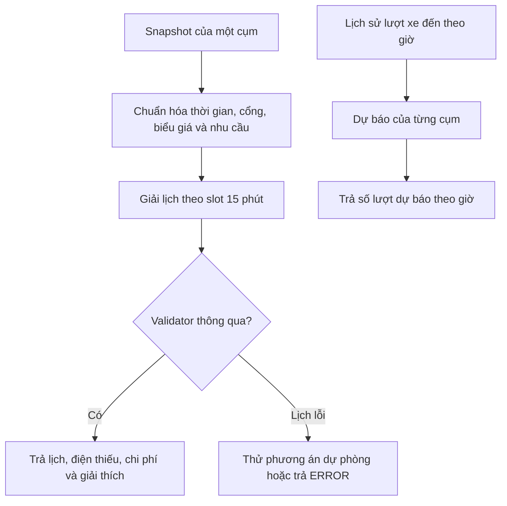
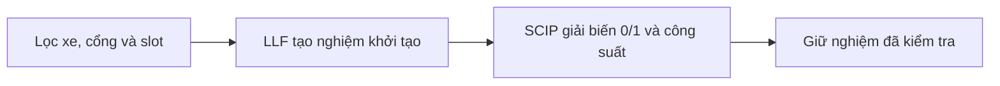
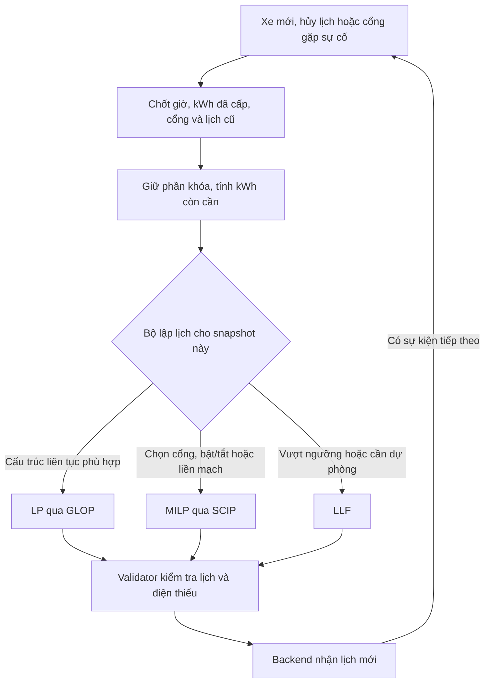
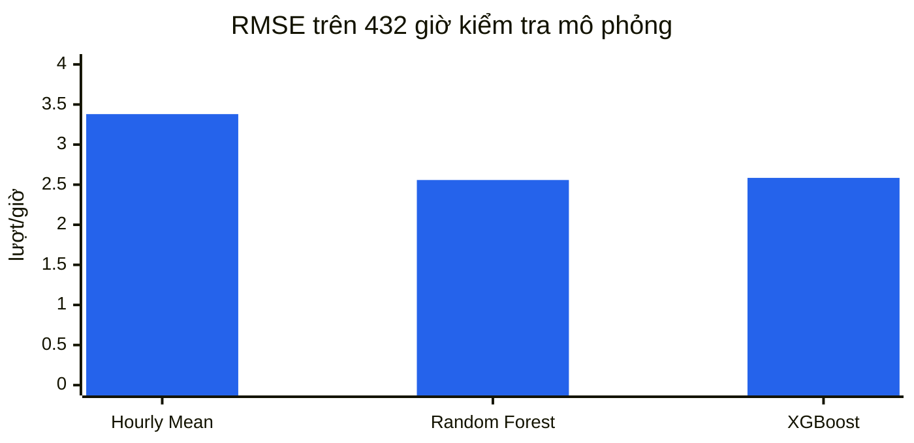
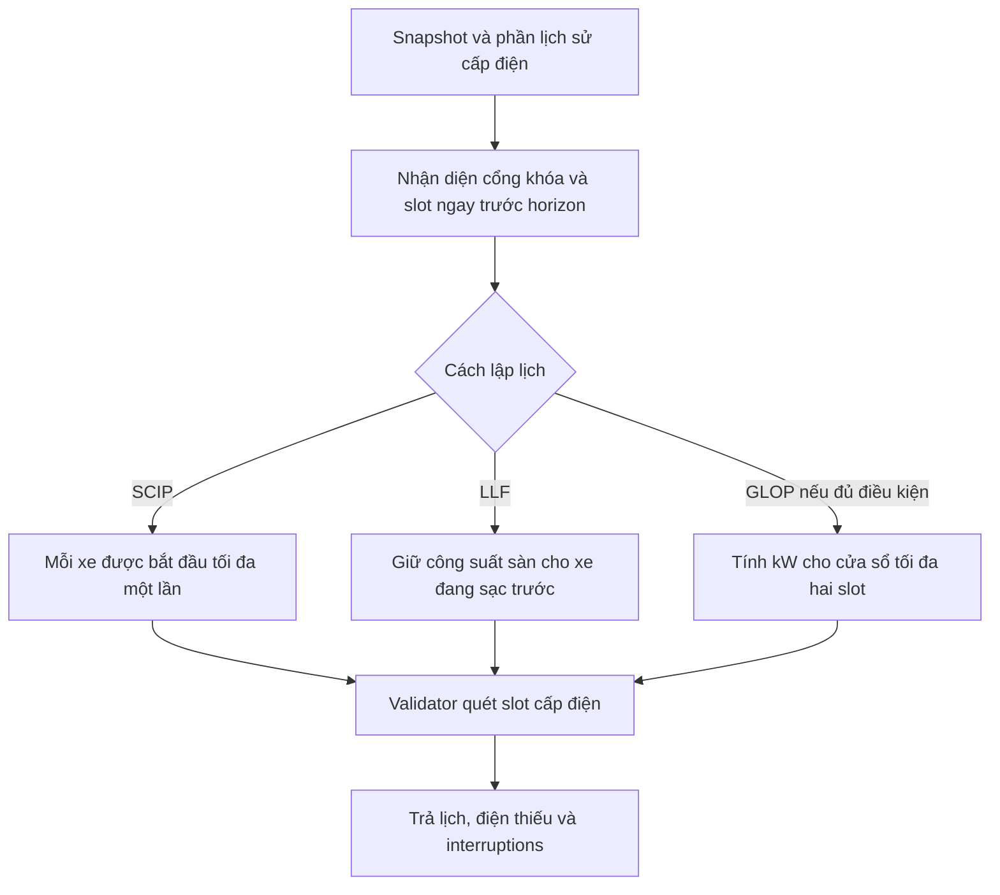

# EV ShareGrid · Báo cáo kỹ thuật AI Engine

**EV ShareGrid giải bài toán xếp lịch sạc khi nhiều xe dùng chung cổng và ngân sách công suất.** Engine trả về cổng, khung 15 phút, công suất và phần điện thiếu của từng xe. Mô hình dự báo xử lý một bài toán riêng: ước lượng số lượt xe đến từng giờ để theo dõi nhu cầu.

Mục 1–7 mô tả bản nền từng đo tại `8b247c1`, với phiên bản riêng ghi cạnh các thí nghiệm mới. [Mục 8](#8-phần-đang-chờ-merge--sạc-liền-mạch) báo cáo thay đổi đang chờ merge tại `23c40e7`, kèm kết quả kiểm tra trước và sau. Xem [bản giải thích chi tiết](AI_Engine_Giai_Thich_Chi_Tiet.md) để đọc công thức, ví dụ và lệnh tái lập.

## 1. Các chữ viết tắt cần biết khi trình bày

| Ký hiệu | Tiếng Anh | Nghĩa trong EV ShareGrid |
|---|---|---|
| **LP** | Linear Programming | **Quy hoạch tuyến tính**. Tính các mức công suất liên tục khi điều kiện gán cổng cho phép. Repo dùng bộ giải **GLOP**. |
| **MILP** | Mixed-Integer Linear Programming | **Quy hoạch tuyến tính nguyên hỗn hợp**. Kết hợp biến rời rạc 0/1 với công suất thực. Repo dùng bộ giải **SCIP**. |
| **MPC** | Model Predictive Control | **Điều khiển dự báo theo mô hình**. Trong dự án, đây là cách giải lại lịch cuốn chiếu khi snapshot thay đổi. |
| **LLF** | Least Laxity First | Xét xe có thời gian dự phòng ít nhất trước. |
| **FCFS** | First Come, First Served | Xét yêu cầu có giờ đến sớm trước. |
| **EDF** | Earliest Deadline First | Xét yêu cầu có giờ rời sớm trước. |
| **ASAP** | As Soon As Possible | Sạc ngay khi có thể, dùng để đối chứng. |
| **XGBoost** | Extreme Gradient Boosting | Dự báo bằng nhiều cây được huấn luyện tuần tự để giảm sai số. |
| **TOU** | Time of Use | Biểu giá điện theo khung giờ. |
| **SOC** | State of Charge | Phần trăm pin. |
| **MAE / RMSE** | Mean Absolute Error / Root Mean Squared Error | Hai chỉ số sai số dự báo. RMSE nhạy hơn với những giờ dự báo lệch nhiều. |

**kW** là công suất. **kWh** là lượng điện. Một slot 15 phút ở 2 kW cấp 0,5 kWh. [Mô hình và quy ước đơn vị](../ai_engine/normalizer.py) · [Lựa chọn bộ giải](../ai_engine/optimizer_milp.py)

## 2. Luồng và hợp đồng dữ liệu

| API của AI Engine | Đầu vào | Đầu ra |
|---|---|---|
| `POST /ai/optimize` | Xe đang cần sạc, giờ đến/rời, điện đã nạp, cổng, trần trạm/cụm, giá và phần lịch khóa. | Lịch theo `request_id`, `port_id`, `slot_start`, `power_kw`. Kèm KPI, trạng thái, thuật toán thực chạy và kết quả từng xe. |
| `POST /ai/benchmark` | Cùng snapshot hoặc mã kịch bản, danh sách thuật toán, seed và số lần lặp. | Từng lần chạy và bảng tổng hợp. |
| `POST /ai/forecast` | Mã cụm, lịch sử giờ và lượt đến, mô hình, số giờ dự báo. | `pred_arrivals` theo giờ, mô hình thực chạy, MAE/RMSE khi có đánh giá. |

Bộ lập lịch dùng các yêu cầu hợp lệ trong snapshot của cụm. Dự báo phục vụ theo dõi nhu cầu theo giờ. Backend gửi dữ liệu và tiếp nhận lịch đề xuất để lưu/công bố. [API](../ai_engine/main.py) · [JSON Schema](../ai_engine/samples/openapi_schemas.json) · [Ánh xạ dữ liệu](../ai_engine/handover/FIELD_MAPPING.md)

## 3. Thuật toán lập lịch

### LP · Phân bổ công suất liên tục

Code dùng LP khi mỗi xe có tối đa một cổng ứng viên, cổng điều chỉnh liên tục từ 0 kW và các cửa sổ sạc không tranh cùng cổng. Trần trạm và cụm vẫn áp dụng ở từng slot. [Điều kiện LP trong code](../ai_engine/optimizer_milp.py) · [GLOP](https://developers.google.com/optimization/lp/lp_advanced)

### MILP · Chọn cổng, bật/tắt và công suất

Với yêu cầu $i$, cổng $j$ và slot $t$, nhóm dùng biến 0/1 để chọn cổng và bật sạc, biến $p_{ijt}$ để biểu diễn công suất, và $g_i$ để biểu diễn điện thiếu. Điều kiện cân bằng là $0{,}25\sum_{j,t}p_{ijt}+g_i=E_i^{\text{còn cần}}$. Các ràng buộc kiểm tra loại cổng, giờ đỗ, giờ mở trạm, công suất xe/cổng và hai trần tổng.

Mục tiêu giải theo tầng **giảm điện thiếu có trọng số → tăng mức đáp ứng thấp nhất trong nhóm cùng trọng số → giảm chi phí → giảm đỉnh và hạn chế thay đổi vận hành**. Khi hết thời gian, engine có thể giữ nghiệm hợp lệ đã tìm được hoặc dùng LLF. [Mô hình, mục tiêu và ngân sách](../ai_engine/optimizer_milp.py) · [SCIP](https://www.scipopt.org/doc/html/)

### FCFS · Xét giờ đến

### EDF · Xét giờ rời

### LLF · Xét thời gian dự phòng

Thời gian dự phòng = thời gian tới giờ rời trừ thời gian ước tính cần sạc ở công suất tối đa phù hợp.

### Equal Share · Chia đều công suất

### ASAP · Đối chứng sạc ngay

ASAP trong benchmark được phép vượt tổng công suất trạm/cụm. Các chính sách dùng chung bước xét cổng, khoảng đỗ và lượng điện còn cần. Hiện có **7 lựa chọn lập lịch chạy được** gồm LP, MILP và 5 chính sách trên. [Mã baseline](../ai_engine/baselines.py)

### MPC · Tính lại lịch trên trạng thái mới

**MPC (Model Predictive Control)** là cơ chế **lập lịch cuốn chiếu**. Mỗi khi có sự kiện như xe mới đặt, khách hủy hoặc cổng hỏng, Backend chốt lại tình hình của cụm. AI tính điện còn cần, giữ phần đã khóa có trong snapshot và gọi bộ lập lịch để giải phần tương lai. Lịch dự kiến được cập nhật khi có dữ liệu tiếp theo. Trong lý thuyết MPC, vòng lặp dùng trạng thái mới để giải một cửa sổ hữu hạn rồi thực hiện quyết định gần nhất. Tại EV ShareGrid, phần AI được kiểm chứng đến bước **trả và bàn giao lịch đề xuất**. [MPC trong tài liệu học thuật](https://www.sciencedirect.com/science/article/abs/pii/S0005109899002149) · [Đường gọi tối ưu lại](../backend/ai_contract.py)

**Mô phỏng chạy qua API ngày 21/11/2026, bản `23c40e7`.** Trạm có hai cổng bật/tắt ở 2 kW, trần trạm và cụm đều là 2 kW. Lúc **16:45**, bộ giải xếp xe A sạc hai slot. Lúc **17:00**, A đã nhận **0,5 kWh**, còn cần **0,5 kWh**. Xe B vừa gửi yêu cầu **0,5 kWh** và phải rời lúc **17:15**. Một slot chỉ đủ công suất cho một cổng. Trong ca này, trọng số MILP của A là 2 và B là 1.

| Bộ lập lịch được gọi trên snapshot 17:00 | Xe được sạc trong slot 17:00 | Kết quả mô phỏng |
|---|---|---|
| **MILP** | A ở cổng 101 | A sạc tiếp cùng cổng. B thiếu **0,5 kWh**. Xét mức thiếu có trọng số, cho A sạc có giá trị mục tiêu **0,5**, cho B sạc có giá trị **1,0**. |
| **LP** | A ở cổng 101 | Yêu cầu LP **thực chạy MILP** vì cổng chỉ có hai mức bật/tắt. |
| **LLF** | A ở cổng 101 | Bản liền mạch ưu tiên cấp tiếp cho xe đang sạc đã được nhận diện. B thiếu **0,5 kWh**. |
| **FCFS / Equal Share** | A ở cổng 101 | FCFS xét A đến trước. Với Equal Share, mỗi cổng cần trọn 2 kW để bật nên ca này chỉ cấp được cho A. |
| **EDF** | B ở cổng 102 | B rời sớm nên được cấp trước. A còn thiếu **0,5 kWh** và không được bắt đầu lại muộn hơn trong horizon này. |
| **ASAP** | Cả A và B | Tổng **4 kW**, ghi **2 vi phạm** trong cùng slot: một ở trạm, một ở cụm. Đây là kết quả đối chứng benchmark. |

Các lịch điều phối trong bảng đều ghi **0 lần vượt trần**. MPC xác định **khi nào cần tính lại và tình hình mới gồm gì**. Bộ lập lịch được gọi xác định **ai sạc ở slot đó**. Với cấu hình mặc định, cụm trên **250 yêu cầu cần giải** dùng LLF toàn cụm. [Thí nghiệm MPC hai lần chạy](AI_Engine_Giai_Thich_Chi_Tiet.md#127-thí-nghiệm-mpc-hai-lần-gọi-api)

### Độ phức tạp của phần lập lịch

| Thành phần | Cận để trình bày |
|---|---|
| Dựng lựa chọn | Với $N$ xe, $P$ cổng, $T$ slot, tối đa $NPT$ bộ ba xe–cổng–slot. Mô hình chỉ tạo biến cho lựa chọn sau khi lọc. |
| FCFS / EDF | Sắp xe một lần $O(N\log N)$, quét tối đa $O(TN)$, cộng chi phí dò cổng. |
| LLF | Phần quét và sắp lại theo slot có cận $O(TN\log N)$ với $N\ge2$, cộng chi phí dò cổng. |
| Equal Share / ASAP | Equal Share sắp các mức sàn/trần, $O(m\log m)$ cho một lần chia có $m$ xe. ASAP quét tối đa $O(TN)$ lượt kiểm tra xe. Cả hai còn chi phí dò cổng. |
| LP / MILP | LP tổng quát có thuật toán thời gian đa thức theo kích thước mã hóa. GLOP dùng simplex. MILP có tối đa $2^B$ cách gán $B$ biến nhị phân trước khi cắt nhánh. |
| Validator | Kỳ vọng $O(R+N+F)$ với $R$ dòng lịch trả về và $F$ dòng lịch cũ. |

$2^B$ đếm khả năng gán biến. Thời gian thực nghiệm của SCIP phụ thuộc vào cấu trúc dữ liệu, số tầng mục tiêu và ngân sách giải. [Độ phức tạp LP](https://www.mathnet.ru/eng/dan42319) · [Bộ giải](../ai_engine/optimizer_milp.py)

## 4. Ba mô hình dự báo

Mục tiêu là dự báo **lượt xe đến mỗi giờ**. Random Forest và XGBoost dùng giờ, thứ, cuối tuần, ngày lễ, lượt đến cách 24/168 giờ và trung bình 24 giờ trước đó. Mỗi dự báo đưa ra số nguyên không âm. [Đặc trưng và huấn luyện](../ai_engine/forecast.py)

### Hourly Mean · Trung bình theo giờ

### Random Forest · Rừng ngẫu nhiên hồi quy

### XGBoost · Cây tăng cường theo gradient

XGBoost dùng độ sâu tối đa 4 và tốc độ học 0,08. Khi lịch sử dưới 336 giờ quan sát hoặc thiếu mô hình phù hợp, hệ thống dùng Hourly Mean. [Random Forest](https://scikit-learn.org/stable/modules/generated/sklearn.ensemble.RandomForestRegressor.html) · [XGBoost](https://xgboost.readthedocs.io/en/stable/tutorials/model.html) · [Cấu hình trong repo](../ai_engine/forecast.py)

## 5. Kết quả dự báo

**Mô phỏng, đo lại ngày 20/11/2026.** Bộ sinh trong repo tạo 2.160 giờ lịch sử giả với seed 42. Cả ba mô hình dùng chung **1.728 giờ huấn luyện** và **432 giờ kiểm tra** từ 14/03 đến hết 31/03/2025, theo giờ Việt Nam. Tập kiểm tra gồm 18 khối 24 giờ. Dự báo trong mỗi khối dùng kết quả dự báo của các bước trước trong chính khối đó khi cần.

| Mô hình | MAE (lượt/giờ) ↓ | RMSE (lượt/giờ) ↓ |
|---|---:|---:|
| Hourly Mean | 2,7477 | 3,3799 |
| Random Forest | 1,9190 | 2,5581 |
| XGBoost | 1,8611 | 2,5847 |

**XGBoost có MAE thấp nhất**, giảm 32,27% so với Hourly Mean, nên chế độ `BEST` chọn XGBoost trong lần đo này. **Random Forest có RMSE thấp nhất**. Hai thước đo ưu tiên các dạng sai số khác nhau. Đây là độ chính xác **trên dữ liệu mô phỏng** có mẫu hình do bộ sinh tạo ra. MAE 1,8611 nghĩa là lệch tuyệt đối trung bình khoảng 1,86 lượt mỗi giờ. [Bộ sinh dữ liệu](../ai_engine/scripts/make_fake_history.py) · [Đánh giá trong code](../ai_engine/forecast.py) · [Cách chạy lại và chi tiết sai số](AI_Engine_Giai_Thich_Chi_Tiet.md)

Ví dụ **mô phỏng** lúc 18:00 ngày đầu holdout, số quan sát là **38 lượt**. Hourly Mean dự báo **34**, Random Forest **35** và XGBoost **35**. Sai số tuyệt đối của ba dự báo tại giờ đó lần lượt là **4, 3 và 3 lượt**.

## 6. Kết quả kiểm thử và benchmark lập lịch

| Kiểm tra ngày 20/11/2026 | Kết quả đo | Cơ sở đối chiếu |
|---|---|---|
| Toàn bộ test AI Engine | **190 đạt**, 4 cảnh báo thư viện | `python -m pytest ai_engine/tests -q` trên Windows, Python 3.12.10. |
| MILP, bài mẫu bốn xe **Minh họa** | `MILP_MPC / OPTIMAL`, **4/4** xe đủ điện, **2,50 kWh**, **5.500 đ**, đỉnh **3 kW**, **0** vượt trần | [Snapshot](../ai_engine/samples/page20_input.json) · [Test nghiệm thu](../ai_engine/tests/test_acceptance.py) |
| LP, biến thể một xe và một cổng **Minh họa** | `LP_MPC / OPTIMAL`, gần **1,00 kWh**, khoảng **2.000 đ**, đỉnh **1,333333 kW**, **0** vượt trần | Giữ xe A, trạm 10 và cổng 101 từ snapshot trên. [Mã tái lập](AI_Engine_Giai_Thich_Chi_Tiet.md) |
| Validate và fallback | Các ca công suất, cổng, khung giờ, freeze và fallback đạt trong bộ test | [Test Validator](../ai_engine/tests/test_validator.py) · [Test API](../ai_engine/tests/test_main.py) |
| Dự báo | Các ca dự báo đủ 24 giờ, fallback, chọn `BEST` và ngưỡng MAE được kiểm tra | [Test Forecast](../ai_engine/tests/test_forecast.py) |

**Benchmark mô phỏng đã lưu ngày 19/11/2026, seed 42.** TOU dưới đây là giá giả định theo khung giờ. `solve_ms` là tổng thời gian xử lý hai cụm, theo phép đo của engine.

| Kịch bản | Thuật toán thực chạy | Đúng hạn | Thiếu (kWh) | Chi phí (đ) | Đỉnh (kW) | Vượt trần | solve_ms |
|---|---|---:|---:|---:|---:|---:|---:|
| 100 yêu cầu, TOU | MILP | 94% | 17,5719 | 7.172.282,48 | 681,0700 | 0 | 15.708,39 |
| 100 yêu cầu, TOU | MILP khi yêu cầu LP | 94% | 17,5719 | 7.172.282,48 | 681,0700 | 0 | 15.926,78 |
| 100 yêu cầu, TOU | LLF | 94% | 17,5719 | 7.190.587,84 | 684,0876 | 0 | 10,14 |
| 100 yêu cầu, TOU | EDF | 94% | 17,5719 | 7.190.587,84 | 684,0876 | 0 | 11,34 |
| 100 yêu cầu, TOU | FCFS | 94% | 17,5719 | 7.207.205,28 | 773,6312 | 0 | 8,60 |
| 100 yêu cầu, TOU | Equal Share | 94% | 17,5719 | 7.207.205,28 | 773,6312 | 0 | 9,94 |
| 100 yêu cầu, TOU | ASAP | 94% | 17,5719 | 7.207.205,28 | 773,6312 | 0 | 8,53 |
| 500 yêu cầu, TOU | LLF cụm 1, MILP cụm 2 | 68,4% | 2.613,4802 | 37.246.807,04 | 850 | 0 | 11.331,22 |
| 500 yêu cầu, TOU | ASAP | 67% | 4.777,7031 | 32.592.305,04 | 2.220 | 53 | 52,77 |
| 10.000 yêu cầu, giá cố định | LLF | 1,74% | 224.282,5779 | 42.161.966,00 | 850 | 0 | 707,04 |

- **100 yêu cầu.** MILP giảm tiền điện **0,2546%** và giảm đỉnh **0,4411%** so với LLF trên cùng kịch bản TOU. Hai bên giữ 94% đúng hạn và cùng điện thiếu ở độ chính xác hiển thị.
- **500 yêu cầu.** Cụm 294 yêu cầu dùng LLF vì vượt ngưỡng. Cụm 206 yêu cầu chạy MILP. So riêng cụm 206 ở giá TOU, MILP giảm **0,3952%** tiền điện so với LLF.
- **10.000 yêu cầu.** Đây là phép đo thông lượng LLF cho hai cụm trong kịch bản quá tải, horizon **138 slot (34,5 giờ)**. Nhu cầu khoảng **245.364 kWh**. Mốc **20.400 kWh** trong báo cáo là năng lực lý thuyết của hai cụm trong **24 giờ**. Khả năng phục vụ 10.000 người dùng truy cập đồng thời cần một phép đo tải của cả hệ thống.

[Nguồn JSON của bảng](../ai_engine/benchmark_real.json) · [Cách gộp số liệu](../ai_engine/scripts/benchmark_real.py) · [Báo cáo benchmark](../ai_engine/README.md)

## 7. Phạm vi kết luận

Bản hiện tại đã kiểm chứng luồng **snapshot → tối ưu → kiểm tra → kết quả**, đồng thời so sánh ba mô hình dự báo trên cùng holdout mô phỏng. Phân rã **Master LP–Station Worker**, **CP-SAT** và **NSGA-II** nằm trong thiết kế mở rộng. Độ chính xác dự báo trên dữ liệu vận hành thực tế và năng lực phục vụ đồng thời toàn hệ thống cần dữ liệu và phép đo tương ứng. [Trạng thái tích hợp](../README.md) · [Thiết kế mở rộng](huong_dan.md#43-cơ-chế-chạy-thực-tế-vòng-lặp-mpc-15-phút-phân-rã-master-worker-và-validator)

## 8. Phần đang chờ merge · Sạc liền mạch

**Bản đề xuất** `feat/non-preemptive-charging`, commit `23c40e7`, đối chiếu với `origin/develop` tại `ad6c54f`. Đây là thay đổi ở bộ lập lịch. Kết quả dự báo ở mục 5 đo trên cùng mã dự báo và trình sinh lịch sử.

### Bài toán nhóm giải quyết

Lịch cũ có thể cấp điện ở hai slot rẻ cách nhau. Ví dụ xe được sạc lúc 17:00, ngừng lúc 17:15 rồi sạc lại lúc 17:30. Nhánh đề xuất ràng buộc **mỗi yêu cầu được cấp điện trong tối đa một khối slot liên tiếp trên một cổng**, trong phạm vi lịch được tính và lịch sử mà engine nhận diện. Công suất vẫn có thể thay đổi giữa các slot của cổng liên tục. Nếu không đủ tài nguyên để cấp hết, lịch ghi phần điện thiếu. Mục tiêu kỹ thuật là giảm số lần ngừng rồi bật lại giữa phiên.

| Thay đổi | Cách triển khai |
|---|---|
| **MILP** | Thêm biến nhị phân biểu diễn **bắt đầu sạc** ở từng slot. Xe mới có tối đa một lần bắt đầu. Với phiên đã được xác nhận nối từ trước, số lần bắt đầu mới bằng 0. |
| **LLF** | Đưa xe đang sạc lên trước, chừa công suất sàn cho các xe đang sạc, rồi cấp phần còn lại theo slack. Các baseline dùng chung quy tắc giới hạn khối trong một lần lập lịch. |
| **MPC và Validator** | Dùng công suất ở slot ngay trước horizon nếu khớp trạng thái `CHARGING` và cổng khóa. Validator phát hiện bật lại sau một khoảng trống và ghi KPI `interruptions`. |
| **LP** | Giữ đường GLOP cho bài liên tục đủ điều kiện và có cửa sổ tối đa hai slot. Cửa sổ ba slot có thể tạo mẫu bật–tắt–bật nên được chuyển sang SCIP. |

[Mã nguồn và số liệu theo commit](AI_Engine_Giai_Thich_Chi_Tiet.md#128-nguồn-mã-theo-commit) · [Chi tiết để đọc code](AI_Engine_Giai_Thich_Chi_Tiet.md#12-thay-đổi-chưa-merge--sạc-liền-mạch)

### Kết quả kiểm tra nhánh đề xuất

| Lần kiểm tra | Bằng chứng |
|---|---|
| Bộ test AI Engine | **208 đạt**, 4 cảnh báo thư viện, 45,95 giây. |
| Các test sạc liền mạch chạy riêng | **15 đạt**, gồm chọn solver, nối phiên MPC, giữ sàn LLF và phát hiện bật lại. |
| Bộ test Backend | **58 đạt**, 1 cảnh báo thư viện, 7,29 giây. |
| Ca bốn xe **Minh họa** | Vẫn `MILP_MPC / OPTIMAL`, **4/4 xe đủ điện**, **5.500 đ**, **0 lần vượt trần**. Lịch A được xếp vào hai slot kề nhau. |
| Một xe, ba slot **Mô phỏng** | Giá 1.000–4.000–1.000 đ/kWh. Cùng cấp đủ 1 kWh ở 2 kW. Bản nền chọn **17:00 và 17:30**, tốn **1.000 đ**. Nhánh đề xuất chọn **17:00 và 17:15**, tốn **2.500 đ**, `interruptions = 0`. |
| LLF cho 500 yêu cầu **Mô phỏng**, cùng dữ liệu | Đếm độc lập từ lịch cấp điện, bản nền có **104 lần bật lại** (72 và 32 theo cụm), bản đề xuất có **0**. Cả hai có **0 lần vượt trần**. |

**Benchmark mô phỏng đã lưu ngày 20/11/2026**, seed 42, dùng dữ liệu tại `14cec6f` và TOU cấu hình 1.620/2.700/4.212 đ/kWh. Bảng dùng hai bản JSON tại `ad6c54f` và `23c40e7`. Các giá trị trước và sau là số đo của hai phiên bản.

| Kịch bản | Chỉ số | Bản nền → bản đề xuất |
|---|---|---|
| 100 yêu cầu, TOU, MILP | Chi phí và đúng hạn | **8.276.432,26 đ** ở cả hai bản, **94%** đúng hạn. |
| 500 yêu cầu, TOU, LLF | Đúng hạn, thiếu điện | **68% → 73%**, **2.614,1306 → 2.549,4269 kWh** thiếu. |
| 500 yêu cầu, TOU, LLF cụm 1 và MILP cụm 2 | Đúng hạn, thiếu điện, chi phí | **68,4% → 72%**, **2.613,4802 → 2.549,0329 kWh** thiếu, **42.054.657,06 → 42.256.368,57 đ**. Cả hai bản giữ **0 lần vượt trần**. |
| 10.000 yêu cầu, giá cố định, LLF | Thông lượng và đúng hạn | Tổng `solve_ms` **1.052,56 → 1.844,59 ms**, đúng hạn **1,74% → 1,59%**. Đây là phép đo hai cụm trong kịch bản quá tải. |

Mốc 100 dùng biểu giá khác với lần đo 19/11 ở mục 6. Ở mốc 500 mới, khi chỉ xét cụm 206 yêu cầu, MILP giảm **0,3055%** chi phí so với LLF và có tỷ lệ đúng hạn **63,59%** so với **66,02%** của LLF. Nên đọc chi phí cùng lượng điện thiếu và tỷ lệ đúng hạn.

[Mã nguồn và số liệu theo commit](AI_Engine_Giai_Thich_Chi_Tiet.md#128-nguồn-mã-theo-commit)

### Hai hành vi cần chốt trước khi kết luận cả phiên sạc luôn liền mạch

1. **Khoảng nghỉ qua nhiều lần MPC.** Ca kiểm tra có xe `CHARGING` cấp điện lúc 16:30, thiếu dòng cấp điện ở 16:45, snapshot lúc 17:00. Nhánh mới có thể xếp bật lại lúc **17:30** và vẫn báo `interruptions = 0`. Normalizer nhận diện slot liền trước horizon. Nếu yêu cầu nghiệp vụ áp dụng cho **toàn bộ phiên qua nhiều lần xếp lịch**, đây là ca cần xử lý trước khi merge.
2. **Sàn công suất số.** Cổng khai báo sàn 0 có thể nhận lịch **1,9995 → 0,001 → 1,9995 kW**. Validator tính slot giữa là đang cấp điện. Kết quả xác nhận tính liền mạch của lịch mô phỏng. Mức sạc duy trì trên thiết bị thật cần thông số cổng để kiểm chứng.

Tên nhánh `feat/…` cũng vướng quy ước kiểm tra PR của repo, vốn dùng tiền tố `feature/…` cho tính năng. [Mã nguồn và số liệu theo commit](AI_Engine_Giai_Thich_Chi_Tiet.md#128-nguồn-mã-theo-commit)
