# EV ShareGrid · Hướng dẫn chi tiết AI Engine

Bộ lập lịch trả lời **“Mỗi xe dùng cổng nào, ở slot nào, với bao nhiêu kW?”**. Bộ dự báo trả lời **“Một cụm có thể nhận bao nhiêu lượt xe đến ở từng giờ tiếp theo?”**. Tài liệu đi từ dữ liệu, thuật toán và code tới kết quả đo. [Bản dùng để báo cáo](AI_Engine_Bao_Cao.md)

[LP và MILP](#3-lp-và-milp-trong-mã-nguồn) · [LLF và các thuật toán đối chứng](#4-năm-chính-sách-đối-chứng-và-llf-dự-phòng) · [Ba mô hình dự báo](#7-dự-báo-nhu-cầu-theo-giờ) · [Bảng và biểu đồ sai số](#8-kết-quả-dự-báo-đo-lại-trên-cùng-dữ-liệu) · [Kiểm thử và benchmark](#9-kiểm-thử-và-benchmark-lập-lịch) · [Chạy lại các kết quả](#10-chạy-lại-các-kết-quả)

Mục 1–11 giải thích bản nền từng đo tại `8b247c1`. [Mục 12](#12-thay-đổi-chưa-merge--sạc-liền-mạch) đối chiếu nhánh sạc liền mạch `23c40e7` với `ad6c54f` và có [thí nghiệm MPC hai lần gọi API](#127-thí-nghiệm-mpc-hai-lần-gọi-api). Phiên bản cụ thể được ghi cạnh mỗi phép đo mới.

## 1. Từ vựng của dự án

| Tên | Viết đầy đủ | Hiểu trong bài toán sạc |
|---|---|---|
| **LP** | **Linear Programming** | **Quy hoạch tuyến tính**. Tìm các mức công suất thực, ví dụ 1,33 kW, dưới các phương trình và bất phương trình tuyến tính. |
| **MILP** | **Mixed-Integer Linear Programming** | **Quy hoạch tuyến tính nguyên hỗn hợp**. Có cả biến nguyên như bật/tắt 0/1 và biến thực như 1,33 kW. |
| **MPC** | **Model Predictive Control** | **Điều khiển dự báo theo mô hình**. Ở đây là tái lập lịch cuốn chiếu khi có snapshot mới. |
| **GLOP / SCIP** | Tên các bộ giải | Engine gọi chúng qua OR-Tools. GLOP giải LP, SCIP giải MILP. |
| **LLF** | **Least Laxity First** | Xét xe còn ít thời gian dự phòng nhất. |
| **FCFS** | **First Come, First Served** | Xét xe theo giờ đến sớm. |
| **EDF** | **Earliest Deadline First** | Xét xe theo giờ rời sớm. |
| **ASAP** | **As Soon As Possible** | Sạc nhanh nhất có thể khi có cổng. Repo dùng làm đối chứng trong benchmark. |
| **Equal Share** | Chia đều công suất | Chia trong giới hạn mức sàn, mức trần và ngân sách ở slot hiện tại. |
| **XGBoost** | **Extreme Gradient Boosting** | Mô hình dự báo cộng dồn đóng góp của nhiều cây được huấn luyện tuần tự. |
| **SOC** | **State of Charge** | Phần trăm pin. |
| **TOU** | **Time of Use** | Tiền mỗi kWh thay đổi theo khung giờ. |
| **KPI** | **Key Performance Indicator** | Số đo để so sánh lịch, như chi phí và đúng hạn. |
| **MAE** | **Mean Absolute Error** | Trung bình độ lệch tuyệt đối của dự báo. |
| **RMSE** | **Root Mean Squared Error** | Căn bậc hai của trung bình bình phương sai số. Nhạy với lệch lớn. |

**kW** đo tốc độ sạc. **kWh** đo lượng điện. Với slot 15 phút, $\Delta t=0{,}25$ giờ. Cổng chạy 2 kW qua một slot cấp $2\times 0{,}25=0{,}5$ kWh. Với cổng giữ nguyên 2 kW, để cấp 1 kWh cần hai slot. Khoảng lập lịch gọi là **horizon**. Backend hiện tạo horizon 24 giờ, tức 96 slot. [Quy ước slot](../ai_engine/normalizer.py) · [Horizon đặt lịch](../README.md#giới-hạn-hiện-tại-và-nguồn-dữ-liệu)

## 2. Bản đồ luồng do AI Engineer phụ trách

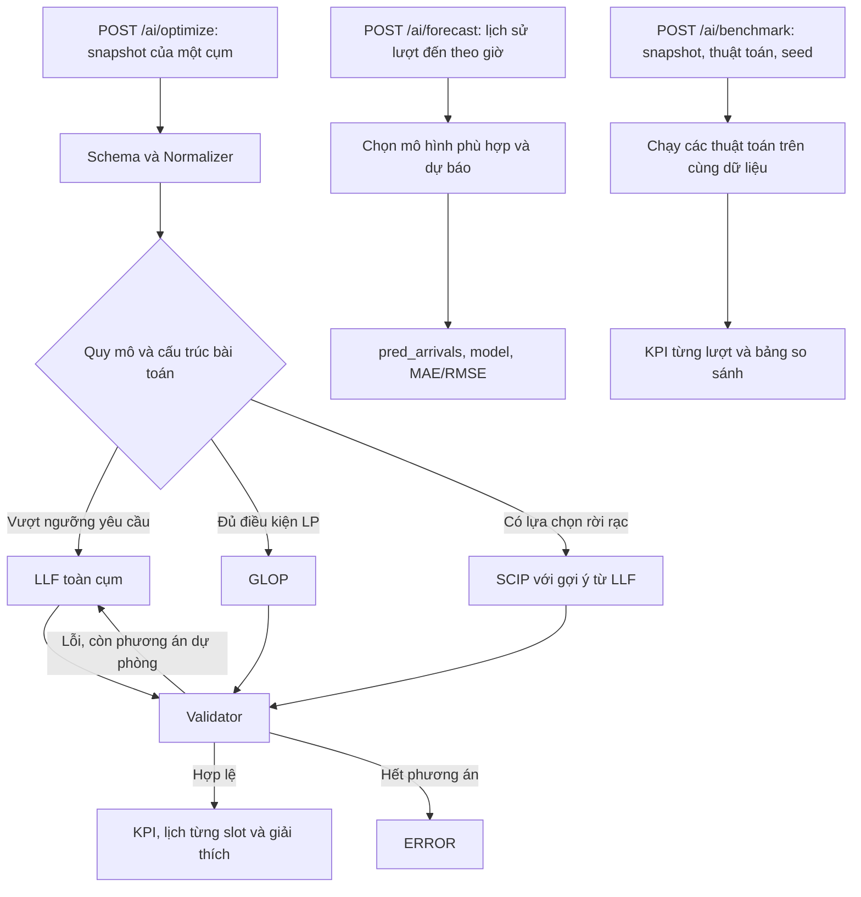

Backend tạo snapshot và nhận lịch đề xuất để lưu. Phần AI gồm hợp đồng JSON, chuẩn hóa, bộ giải, Validator, Explainer, benchmark và dự báo. Chữ `snapshot` chỉ ảnh chụp dữ liệu cho một lượt giải. `input_version` và `snapshot_time` giúp truy vết nó. [API](../ai_engine/main.py) · [Gửi snapshot từ Backend](../backend/ai_contract.py) · [Ánh xạ dữ liệu](../ai_engine/handover/FIELD_MAPPING.md)

### 2.1. Input thật của bộ lập lịch

| Nhóm | Các trường chính | Cách engine dùng |
|---|---|---|
| Thông tin lần giải | `cluster_id`, `input_version`, `snapshot_time`, `slot_minutes`, `horizon_slots`, `time_budget_ms` | Xác định cụm, thời điểm chốt, độ dài horizon và ngân sách giải. Schema yêu cầu slot 15 phút và ngày giờ `+07:00`. |
| Cụm | `grid_limit_kw` | Giới hạn tổng kW của cụm ở từng slot. |
| Trạm | `station_id`, `station_power_kw`, `open_time`, `close_time` | Giới hạn trạm và khung mở cửa trong snapshot. |
| Cổng | `port_id`, `connector_type`, `control_type`, `min_power_kw`, `max_power_kw`, `status` | Chọn cổng tương thích. `CONTINUOUS` điều chỉnh theo dải. `ON_OFF_SWITCH` cấp 0 hoặc công suất định mức. |
| Xe/yêu cầu | `request_id`, `station_id`, `connector_type`, `vehicle_max_kw`, `arrival_time`, `departure_time`, `energy_needed_kwh`, `energy_delivered_kwh`, `priority_weight`, `status` | Tính điện còn lại, khoảng có thể sạc và mức ưu tiên dùng ở MILP. Request được gắn với trạm đã chọn. |
| Trạng thái phiên, lịch cũ | `locked_port_id`, `previous_port_id`, `previous_schedule[]` | Nhận cổng đang khóa, tham chiếu lịch freeze và hỗ trợ tính lịch lại. |
| Biểu giá | `tariffs[].start_time`, `end_time`, `price_vnd_kwh` | Tính giá từng slot. Giá có thể là khoảng ngày giờ cụ thể hoặc giờ lặp hằng ngày. |
| Pin, nếu có | `current_soc_pct`, `battery_capacity_kwh` | Ước lượng phần trăm pin sau lịch. |

Nguồn chính là các lớp `OptimizeRequest`, `Station`, `Port` và `ChargingRequestIn`. [Schema Python](../ai_engine/schemas.py) · [Snapshot đầy đủ để mở xem](../ai_engine/samples/page20_input.json)

### 2.2. Normalizer biến input thành thứ solver đọc được

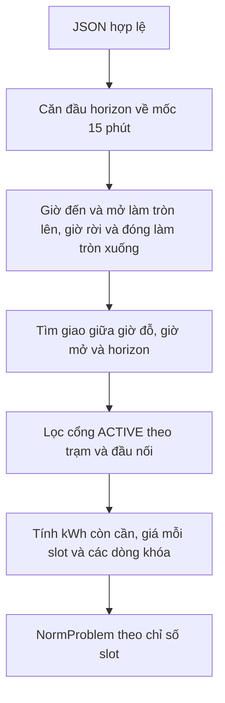

- **Thời gian.** Xe đỗ từ 17:07 đến 17:46 có đủ hai slot **17:15–17:30** và **17:30–17:45**. Slot được hiểu là khoảng nửa kín `[bắt đầu, kết thúc)`. Xe có thể dùng slot kết thúc đúng giờ rời.
- **Trạng thái.** Pool của Backend gồm `PENDING`, `SCHEDULED`, `CONFIRMED` và `CHARGING` trong phạm vi áp dụng. Normalizer loại các yêu cầu đã đủ điện và trạng thái kết thúc khỏi phần cần giải.
- **Năng lượng.** $E_i=\max(0,E_i^{\mathrm{needed}}-E_i^{\mathrm{delivered}})$. Ví dụ xe cần 1 kWh và đã nhận 0,5 kWh, solver chỉ còn cần xếp 0,5 kWh. Trước khi gửi snapshot, Backend tính nhu cầu từ chênh lệch SOC, dung lượng pin và hiệu suất 0,90 trong luồng booking hiện tại.
- **Giá.** Biểu giá phải phủ đủ horizon và tránh chồng lấn. Nếu giá đổi giữa một slot, code lấy trung bình theo thời lượng. **Minh họa:** 5 phút ở 4.000 đ/kWh và 10 phút ở 2.000 đ/kWh cho giá tương đương 2.666,67 đ/kWh. Xe cấp 0,5 kWh trong slot trả khoảng 1.333,33 đ tiền điện.
- **Ứng viên.** Cổng được lập chỉ mục theo **trạm + loại đầu nối** để nhiều xe chung nhóm dùng lại danh sách. Xe khóa cổng có tập ứng viên bị giới hạn. Việc chọn cổng dự phòng còn phụ thuộc trạng thái cổng và các slot khóa được cung cấp.

[Luồng chuẩn hóa](../ai_engine/normalizer.py) · [Tính nhu cầu trong booking](../backend/routes/requests.py)

### 2.3. Output và cách đọc trạng thái

| Trường | Nghĩa |
|---|---|
| `schedules[]` | Các dòng `request_id`, `port_id`, `slot_start`, `power_kw`. Một xe có thể có nhiều dòng vì dùng nhiều slot. |
| `request_results[]` | `allocated_kwh`, `shortfall_kwh`, `expected_soc`, `estimated_cost_vnd`, `explanation` cho từng xe. |
| `status` | `OPTIMAL` khi các tầng đạt trạng thái tối ưu theo solver. `FEASIBLE` khi có nghiệm hợp lệ với mức chứng minh chưa đầy đủ. `FALLBACK` khi trả phương án dự phòng. `ERROR` khi không có lịch dùng được. |
| `algorithm` / `fallback_reason` | Thuật toán **thực sự** tạo nghiệm và lý do chuyển hướng, như `THRESHOLD_EXCEEDED` hoặc `TIME_BUDGET_EXHAUSTED`. |
| `kpi` / `solve_ms` | KPI của nghiệm và thời gian xử lý trong engine. Code đo từ chuẩn hóa qua giải và kiểm tra, trước khi dựng KPI, giải thích và đóng gói kết quả thành công. |

**Ví dụ một dòng lịch đo được từ ca bốn xe:**

```json
{"request_id":"C","port_id":"201","slot_start":"2026-11-18T17:00:00+07:00","power_kw":1.0}
```

Dòng này biểu diễn 0,25 kWh ở cổng 201 trong slot 17:00–17:15. `estimated_cost_vnd` là tiền điện theo slot, chưa cộng phí dịch vụ. Khi có cả SOC hiện tại và dung lượng pin, `expected_soc` cộng phần điện cấp thêm theo giả định hiệu suất 100% của bước hiển thị. Khi thiếu một trong hai, giá trị cùng tên biểu diễn **tỷ lệ đáp ứng nhu cầu cả phiên**. Ví dụ mẫu có thể trả 100 để chỉ rằng lịch đáp ứng 100% nhu cầu. [Schema đầu ra](../ai_engine/schemas.py) · [Tạo kết quả](../ai_engine/service.py) · [Giải nghĩa trường SOC](../ai_engine/handover/FIELD_MAPPING.md)

## 3. LP và MILP trong mã nguồn

### 3.1. LP · Khi cần tính mức công suất liên tục

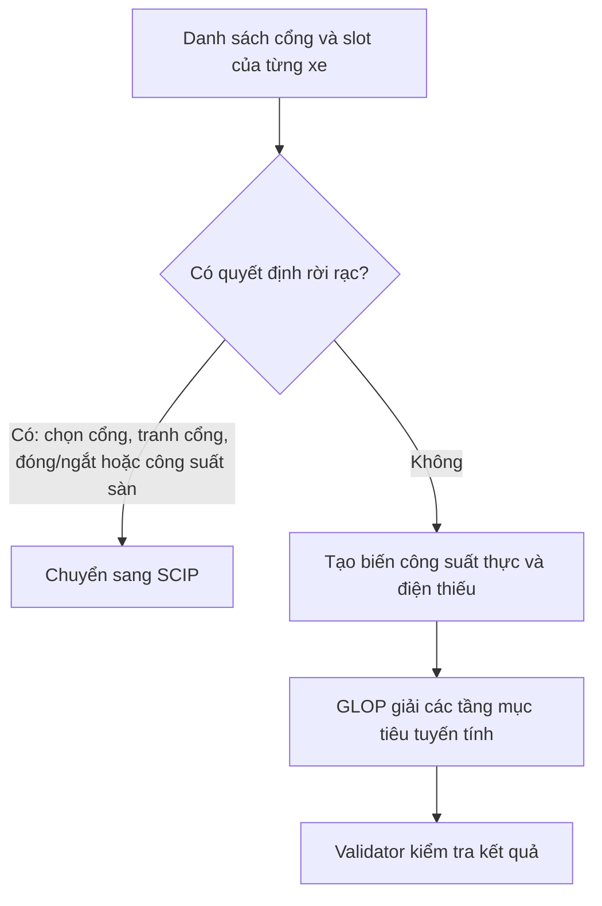

Ví dụ một xe đã có cổng riêng, cổng điều chỉnh liên tục từ 0 đến 2 kW, trong ba slot giá rẻ. Để cấp đủ 1 kWh, tổng công suất qua ba slot phải xấp xỉ 4 kW. Các mức `2 + 2 + 0` và `1,333333 + 1,333333 + 1,333333` cùng cấp xấp xỉ 1 kWh, nhưng mức thứ hai làm đỉnh thấp hơn. Với giá như nhau và các điều kiện khác giữ nguyên, tầng giảm đỉnh có thể chọn phương án thứ hai. Đây cũng là ca chạy GLOP ở mục 9.

Điều kiện chính xác trong code là mỗi request có **tối đa một cổng ứng viên**, các request **không tranh cùng cổng trong các slot ứng viên**, cổng **CONTINUOUS** và mức sàn bằng 0 trong dung sai. Hai xe ở hai cổng riêng vẫn có thể tranh cùng ngân sách trạm/cụm. Điều đó vẫn biểu diễn tuyến tính. Một yêu cầu benchmark gửi `LP_MPC` có thể nhận `MILP_MPC` nếu dữ liệu cần biến rời rạc. [Chọn GLOP hoặc SCIP](../ai_engine/optimizer_milp.py) · [Tài liệu simplex GLOP](https://developers.google.com/optimization/lp/lp_advanced)

### 3.2. MILP · Khi phải chọn cổng hoặc bật/tắt

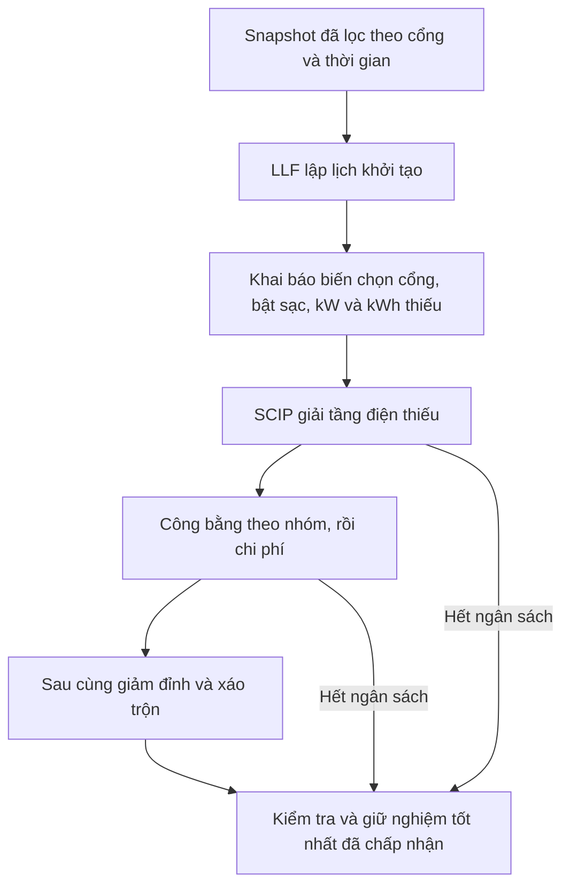

**Các biến.** Với xe $i$, cổng $j$, slot $t$, $y_{ij}$ và $x_{ijt}$ là biến 0/1 chỉ việc chọn cổng và bật sạc. $p_{ijt}\ge0$ là mức kW. $g_i\ge0$ là kWh còn thiếu. $z\ge0$ là công suất đỉnh của cụm. Từ `Mixed-Integer` chỉ sự kết hợp biến nguyên và biến thực. Từ `Linear` chỉ việc ràng buộc và từng mục tiêu đều là tổ hợp tuyến tính của các biến.

| Ràng buộc | Viết toán và ý nghĩa |
|---|---|
| **Điện còn cần** | $\sum_{j,t}p_{ijt}\Delta t+g_i=E_i$. Điện được lập lịch cộng phần thiếu phải bằng nhu cầu còn lại. |
| **Giữ một cổng cho request** | $\sum_j y_{ij}\le 1$ và $x_{ijt}\le y_{ij}$. Các slot được cấp điện của một request đi qua cổng đã chọn. |
| **Trùng cổng theo slot** | $\sum_i x_{ijt}\le 1$. Một cổng cấp điện cho tối đa một request trong mỗi slot. |
| **Cổng liên tục** | $P_j^{\min}x_{ijt}\le p_{ijt}\le \min(P_i^{\max},P_j^{\max})x_{ijt}$. Nếu tắt thì công suất bằng 0. Nếu bật thì theo dải cho phép. |
| **Cổng bật/tắt** | $p_{ijt}=P_j^{\mathrm{on}}x_{ijt}$, đồng thời áp giới hạn xe. Nếu xe nhận tối đa 3 kW mà cổng chỉ bật ở 4 kW thì cổng không cấp được ở chế độ đó. |
| **Trần trạm** | $\sum_{i,j\in s}p_{ijt}\le C_s$ với mọi trạm $s$ và slot $t$. |
| **Trần cụm và đỉnh** | $\sum_{i,j}p_{ijt}\le z\le C_{\mathrm{grid}}$ ở mọi slot. |
| **Slot khóa** | Áp đẳng thức công suất cũ cho dòng freeze hợp lệ được gửi vào, theo quy ước của snapshot. |

**Minh họa về bật/tắt.** Cổng 1 kW cấp theo bội 0,25 kWh cho mỗi slot. Xe còn cần 0,60 kWh có thể nhận 0,50 kWh qua hai slot và báo thiếu 0,10 kWh. Bật slot thứ ba sẽ cấp 0,75 kWh, vượt nhu cầu trong mô hình.

Bản MILP kiểm tra đụng cổng ở các slot cấp điện. Baseline có thể giữ cổng từ lúc gán đến giờ xe rời. Nếu áp dụng nghiệp vụ chiếm vị trí vật lý suốt thời gian cắm, phần ràng buộc chiếm cổng cần được diễn tả rõ trong mô hình và lúc vận hành. [Biến và ràng buộc](../ai_engine/optimizer_milp.py) · [Giữ cổng ở baseline](../ai_engine/baselines.py) · [Kiểm tra độc lập](../ai_engine/validator.py)

### 3.3. Hàm mục tiêu và thứ tự ưu tiên

1. **Điện thiếu.** Tối thiểu hóa $\sum_i w_i g_i$. Code còn đặt giới hạn điện thiếu có trọng số và tổng điện thiếu theo nghiệm LLF ban đầu.
2. **Công bằng theo nhóm.** Với mỗi nhóm cùng trọng số, tối đa hóa tỷ lệ được cấp thấp nhất. Tỷ lệ xe $i$ là $1-g_i/E_i$ với $E_i>0$. Nhóm trọng số cao được xét trước ở tầng này.
3. **Tiền điện.** Tối thiểu hóa $\sum_{i,j,t}\mathrm{price}_t p_{ijt}\Delta t$. Khi chất lượng phục vụ giữ nguyên, chuyển sạc sang giá thấp có thể cải thiện mục tiêu.
4. **Ổn định vận hành.** Code dùng một tổng gồm đỉnh $z$, biến động bật/tắt của cổng và độ lệch công suất ở các vị trí được so với lịch cũ.

**Minh họa công bằng:** hai xe cùng trọng số cần 4 và 8 kWh, tổng điện có thể cấp là 6 kWh. Nếu mọi điều kiện khác cho phép, chia 2 và 4 kWh cho hai xe đều đạt 50%. Chia 4 và 2 kWh cho xe đầu đạt 100% và xe sau 25%. Cả hai lịch cùng thiếu 6 kWh, nhưng cách chia đầu có tỷ lệ thấp nhất cao hơn.

Code khóa giá trị mục tiêu đã chấp nhận bằng ràng buộc có dung sai trước khi sang tầng sau. Nếu thiếu thời gian, engine có thể trả một nghiệm `FEASIBLE` đã kiểm tra. Chữ tối ưu được dùng cho những tầng mà solver đã chứng minh trong phạm vi mô hình và dung sai. [Giải theo tầng](../ai_engine/optimizer_milp.py) · [Test giữ nghiệm và tiếp tục mục tiêu](../ai_engine/tests/test_milp_stages.py)

## 4. Năm chính sách đối chứng và LLF dự phòng

Các chính sách dùng chung vòng lặp theo slot. Đầu mỗi slot, code xét yêu cầu còn nhu cầu và nằm trong cửa sổ sạc. Khi cấp điện, code dò cổng khả dụng, kiểm tra định mức xe/cổng và cập nhật kWh còn thiếu. Với lịch điều phối, cả trần trạm và cụm cùng giới hạn mức cấp. [Vòng lặp chung](../ai_engine/baselines.py)

### 4.1. FCFS · Xếp theo giờ đến

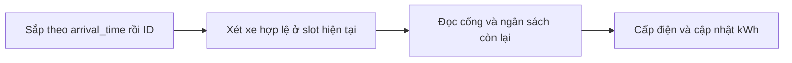

**Minh họa:** A đến 16:45 và rời 18:00. B đến 17:00 và rời 17:30. Nếu cả hai cùng hợp lệ ở 17:00, FCFS xét A trước. FCFS tạo đường cơ sở để đo chính sách theo thứ tự đến. [FCFS](../ai_engine/baselines.py)

### 4.2. EDF · Xếp theo giờ rời


Trong cùng ví dụ, EDF xét B trước vì B rời 17:30. EDF chỉ dùng deadline để sắp thứ tự. Nhu cầu kWh được dùng ở bước cấp công suất. [EDF](../ai_engine/baselines.py)

### 4.3. LLF · Xét thời gian dự phòng còn lại

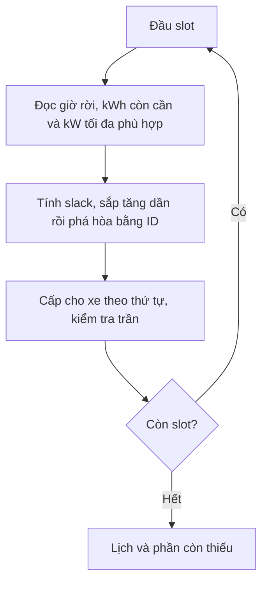

$$
\operatorname{slack}_i(t)=(d_i-t)-\frac{E_i^{\text{còn}}}{P_i^{\max}}.
$$

**Minh họa:** ở 17:00, A phải đi lúc 17:45 và cần sạc 15 phút, slack là 30 phút. B rời 18:00 và cần sạc 45 phút, slack là 15 phút. EDF xét A trước, LLF xét B trước. Slack âm nghĩa là ngay cả khi sạc ngay ở công suất ước tính tối đa, thời gian còn lại không đủ.

Mức $P_i^{\max}$ trong phép xếp hạng là ước lượng từ xe và cổng ứng viên. Khi thực sự cấp điện, code còn kiểm tra cổng bận, trần trạm/cụm, mức sàn và kWh còn cần. LLF tính lại ở từng slot vì giờ rời tiến gần và xe vừa sạc sẽ giảm nhu cầu. Trong optimizer, lịch LLF được dùng làm nghiệm khởi tạo và phương án dự phòng. [LLF](../ai_engine/baselines.py) · [Dùng LLF để khởi tạo](../ai_engine/optimizer_milp.py)

### 4.4. Equal Share · Chia công suất trong slot


Hàm `_fill` dùng cách *water filling*. Với mỗi xe có cận dưới $l_i$ và cận trên $u_i$, thử mức chung $\lambda$ rồi giới hạn $p_i=\min(u_i,\max(l_i,\lambda))$. Khi tổng chạm ngân sách thì dừng. **Minh họa:** hai xe có trần 2 và 4 kW, ngân sách 5 kW, mức sàn đều 0. Tăng đều tới 2 kW cho hai xe, sau đó phần 1 kW dư chuyển cho xe còn khả năng. Kết quả là 2 và 3 kW. Code lặp chia dưới ngân sách từng trạm rồi dưới ngân sách cụm. [Water filling](../ai_engine/baselines.py)

### 4.5. ASAP · Đối chứng sạc ngay


ASAP cho xe sạc ngay ở công suất phù hợp với xe/cổng. Bài benchmark cố ý bỏ trần tổng trạm và cụm cho thuật toán này để đo điểm khác biệt. Validator trong đường benchmark chỉ chấp nhận ngoại lệ đối với hai loại lỗi vượt trần đó. [ASAP](../ai_engine/baselines.py) · [Đường xử lý đối chứng](../ai_engine/service.py)

## 5. MPC, Validator, fallback và Explainer

### 5.1. MPC · Giải lại khi snapshot thay đổi

**Model Predictive Control (MPC)** là **điều khiển dự báo theo mô hình**. Ý tưởng học thuật là chốt trạng thái hiện tại, giải một cửa sổ tương lai hữu hạn, thực hiện quyết định gần nhất rồi giải lại khi đã có trạng thái mới. Tại EV ShareGrid, cách áp dụng là **lập lịch cuốn chiếu theo sự kiện**. Engine trả lịch dự kiến cho phần khả dụng của horizon để Backend lưu và cung cấp cho người dùng. Việc thực thi lệnh trên cổng sạc thật là một điểm tích hợp riêng. [Mayne và cộng sự về MPC](https://www.sciencedirect.com/science/article/abs/pii/S0005109899002149) · [Hợp đồng AI–Backend](../ai_engine/handover/FIELD_MAPPING.md)

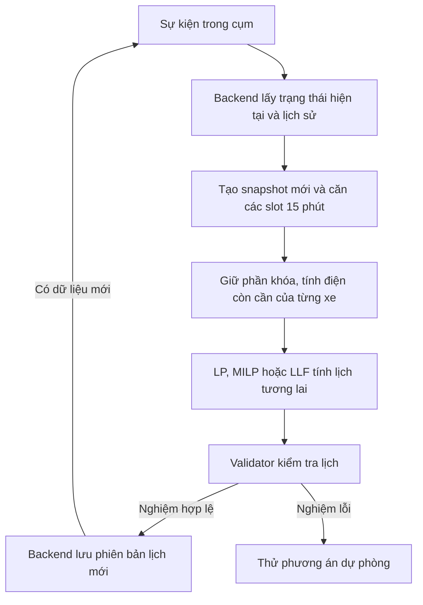

| Bước của vòng MPC | Việc làm cụ thể trong repo |
|---|---|
| **1. Nhận sự kiện** | Backend gọi tối ưu lại khi đặt mới, hủy, check-in muộn, cổng gặp sự cố, thay đổi trần hoặc biểu giá. Từng slot dài 15 phút. Chu kỳ tự gọi đều mỗi 15 phút là một phương án thiết kế vận hành. |
| **2. Đọc trạng thái tại thời điểm $k$** | Lấy các yêu cầu còn hiệu lực của cùng cụm. Trạng thái gồm `energy_delivered_kwh` từ phiên sạc, giờ đến/rời, `locked_port_id` của phiên đang chạy, thông số cổng, hai trần và biểu giá. |
| **3. Dựng horizon và khóa phần cần giữ** | Căn đầu horizon theo mốc 15 phút. Đường booking dùng 24 giờ. Phân biệt dòng của slot đã qua, dòng đang khóa nếu có và phần còn được xếp lại. Chuẩn hóa cấp chỉ số `first_mutable_slot` cho slot đầu có thể sửa. |
| **4. Giải phần tương lai** | Dùng LP hoặc MILP theo cấu trúc snapshot. LLF tạo nghiệm đầu hoặc thay thế khi cần. FCFS, EDF, Equal Share và ASAP có thể được gọi trong benchmark để đối chiếu cùng một snapshot. |
| **5. Đối chiếu và trả kết quả** | Validator kiểm tra cổng, slot, công suất và kWh. Backend nhận lịch hợp lệ, giữ phần lịch quá khứ và ghi phiên bản mới cho các slot còn có thể đổi. |
| **6. Dời cửa sổ khi trạng thái đổi** | Ở lần gọi sau, thời điểm chốt và điện đã nhận có thể khác. Engine dùng số mới để tính phần còn lại của từng xe, rồi chọn lại lịch tương lai. |

Với xe $i$ tại lần chốt $k$, điện còn cần là $E_i^{\text{còn}}(k)=\max(0,E_i^{\text{yêu cầu}}-E_i^{\text{đã cấp}}(k))$. Ví dụ xe yêu cầu **1 kWh** và đã ghi nhận **0,5 kWh** thì lượt mới chỉ cần tính lịch cho **0,5 kWh**. Công suất 2 kW trong slot 15 phút dự kiến cấp thêm 0,5 kWh. Số thực nhận ở lần chốt sau đến từ dữ liệu phiên sạc. [Dựng snapshot và lưu phiên bản](../backend/ai_contract.py) · [Đặt lịch lại khi check-in muộn](../backend/routes/request_actions.py) · [Chuẩn hóa slot](../ai_engine/normalizer.py)

Nếu một cụm được tính lại $K$ lần thì công việc của vòng MPC là tổng chi phí **chuẩn hóa + giải + kiểm tra** của $K$ snapshot. Hai lần dùng cùng horizon vẫn có thể tốn thời gian khác nhau vì tập yêu cầu, tập cổng ứng viên và bộ giải thay đổi. Chữ **predictive** ở đây gắn với việc tính diễn biến năng lượng trong các slot tương lai từ công suất dự kiến. Các mô hình Hourly Mean, Random Forest và XGBoost xử lý bài toán dự báo lượt đến riêng ở mục 7.

**Hai trường dữ liệu dễ nhầm.** `energy_delivered_kwh` là số điện đã ghi nhận từ phiên sạc. `previous_schedule[]` là các dòng lịch cũ mà Backend truyền vào để xác định phần đã khóa hoặc lịch sử hữu ích. Với dòng freeze đang chạy được gửi vào snapshot, cách chốt điện đã giao phải thống nhất để solver không tính một phần điện hai lần. Đường dựng snapshot trong repo lấy **dòng có thời điểm kết thúc trước hoặc bằng mốc horizon**. Vì vậy, khả năng giữ đúng công suất của slot đang chạy phụ thuộc vào dữ liệu thực tế mà bên gọi cung cấp. [Quy ước freeze](../ai_engine/handover/FIELD_MAPPING.md) · [Truy vấn lịch cũ](../backend/ai_contract.py)

**Một ví dụ có đủ hai lần giải.** Ở 16:45, A được xếp hai slot để nhận 1 kWh. Ở 17:00, lượt giải mới chỉ còn phải cấp 0,5 kWh cho A, đồng thời cân nhắc B vừa gửi yêu cầu. Nhánh liền mạch nhận diện A đã sạc ở slot 16:45, nên MPC phải đưa thông tin này vào ràng buộc khi chọn lịch 17:00. Bảng thử tại mục 12.7 cho thấy MILP, LLF và EDF có thể trả lịch khác nhau dù nhận **cùng một snapshot**. [Xem ví dụ và kết quả từng thuật toán](#127-thí-nghiệm-mpc-hai-lần-gọi-api)

### 5.2. Validator · Kiểm tra nghiệm độc lập

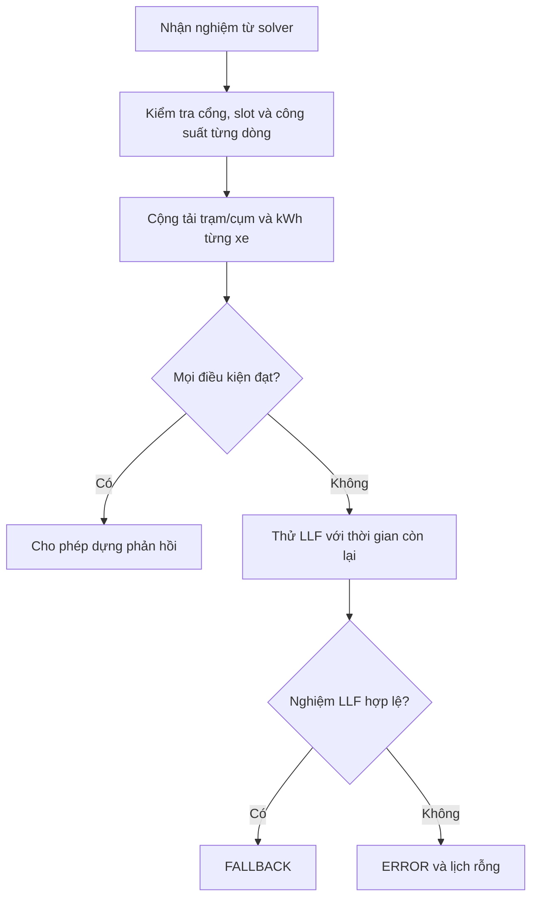

- **Trùng cổng** là hai xe được cấp điện từ cùng một cổng trong cùng slot, kể cả tổng kW thấp. Hai xe dùng cùng cổng ở hai slot kề nhau thì không trùng theo phép kiểm tra slot.
- **Vượt trần** được kiểm tra riêng cho trạm và cụm. Ví dụ trạm A tối đa 6 kW, trạm B tối đa 4 kW, cụm tối đa 8 kW. Nếu A dùng 3 kW, B dùng tối đa $\min(4,8-3)=4$ kW.
- **Điện thiếu hợp lệ** vẫn được trả. Nếu xe cần 1 kWh nhưng chỉ có một slot ở 2 kW, engine có thể xếp 0,5 kWh và ghi 0,5 kWh thiếu.
- **Dung sai** kiểm tra công suất và năng lượng là $10^{-6}$ theo đơn vị tương ứng. Mục đích là xử lý sai số số thực khi đối chiếu nghiệm.

Mặc định, trên **250 request cần giải** trong một cụm thì dùng LLF toàn cụm. Từ **300 request trong payload**, schema giới hạn ngân sách snapshot ở **2.000 ms** theo cấu hình mặc định. Đây là hai phép đếm riêng. API chạy optimize trong tiến trình con và có điểm dừng cứng **ngân sách + 500 ms** tính từ lúc handler bắt đầu. Khi chạm hạn đó, phản hồi có thể là `ERROR`. [Kiểm tra và thử dự phòng](../ai_engine/validator.py) · [Cấu hình](../ai_engine/settings.py) · [Ngân sách HTTP](../ai_engine/main.py)

### 5.3. Explainer và KPI

Explainer lập chỉ mục công suất theo từng xe, cổng và slot, gộp các slot liền nhau, tính tiền điện rồi dựng câu giải thích. Nó nhận biết các dấu hiệu như cổng hỏng, cửa sổ quá ngắn, mức sàn vượt khả năng xe, cổng bận hoặc trần công suất bị chạm. Đây là giải thích theo điều kiện quan sát được trên lịch. [Explainer](../ai_engine/explainer.py)

| KPI | Cách tính và đơn vị |
|---|---|
| `total_shortfall_kwh` | Cộng kWh thiếu của các request cần giải. |
| `on_time_rate` | Tỷ lệ request đủ nhu cầu trong thời gian cho phép. |
| `total_cost_vnd` | $\sum p\Delta t\times\mathrm{price}$ cho các dòng lịch. |
| `peak_power_kw` | Công suất lớn nhất của cụm theo slot. Khi gộp benchmark nhiều cụm, lấy đỉnh của tổng tải cùng thời điểm. |
| `cap_violations` | Mỗi cặp trạm–slot hoặc cụm–slot vượt trần được đếm một lần. |
| `fairness` | Chỉ số Jain trên tỷ lệ đáp ứng $u_i$, bằng $(\sum_i u_i)^2/(N\sum_i u_i^2)$ khi mẫu số dương. Đây là KPI chấm lịch. Tầng công bằng của MILP dùng max-min. |

Nguồn tính KPI là [mã baseline](../ai_engine/baselines.py) và [mã benchmark gộp cụm](../ai_engine/scripts/benchmark_real.py).

## 6. Độ phức tạp của lập lịch

Độ phức tạp đo **công việc tăng theo kích thước đầu vào**. Thời gian benchmark còn phụ thuộc máy, dữ liệu, ngân sách, số tầng giải và chi phí gọi dịch vụ.

- $N$ là số yêu cầu cần giải, $T$ là số slot, $P$ là số cổng. Gọi $P_i$ là cổng ứng viên của xe $i$, $W_i$ là số slot hợp lệ. Có $K=\sum_i|P_i|$ cặp xe–cổng và $C=\sum_i|P_i|W_i\le NPT$ bộ ba xe–cổng–slot.
- **Minh họa:** 100 xe, 20 cổng và 96 slot tạo 192.000 bộ ba nếu ghép toàn bộ. Nếu mỗi xe có 2 cổng tương thích và 8 slot hợp lệ thì còn 1.600 bộ ba. Cặp cổng, slot khóa và các biến phụ được xử lý theo mô hình thưa.
- $R$ là số dòng của lịch kết quả. $F$ là số dòng lịch cũ. $a_t$ là số xe được đưa vào xếp hạng ở slot $t$. $Q$ đếm các lượt dựng/thử lựa chọn cổng sau khi lập chỉ mục.

| Thành phần | Chi phí theo kích thước đầu vào |
|---|---|
| Normalizer | Lập chỉ mục cả trạm/cổng, sắp request theo ID và biểu giá theo thời gian. Nếu $M$ là số khoảng giá sau khi mở rộng ngày, chi phí theo các thành phần chính là $O(P+S+N_{\mathrm{in}}\log(N_{\mathrm{in}}+1)+M\log(M+1)+T+F)$, với $S$ là số trạm. |
| FCFS, EDF, ASAP | Chuẩn bị thứ tự xe $O(N\log(N+1))$ và quét danh sách qua slot, cận $O(TN)$ lượt kiểm tra xe. Phần chuẩn bị và dò cổng tính thêm. |
| LLF | Quét qua các slot và sắp lại mỗi lần. Phần quét/sắp là $O(TN+\sum_t a_t\log(a_t+1))$, cận trên $O(TN\log(N+1))$. |
| Dò cổng ở baseline | Quét các cổng ứng viên và lập danh sách cổng rảnh theo nhóm. Mỗi lần cần thử khóa tương lai ở một cổng, tìm nhị phân trong $L$ khoảng khóa tốn $O(\log(L+1))$, ngoài công việc duyệt $Q$ lựa chọn và sắp dữ liệu ban đầu. |
| Equal Share | Mỗi lần chia công suất cho $m$ xe cần sắp mức sàn/trần, $O(m\log(m+1))$. Có thêm chi phí quét xe, dò cổng và chia ở cả trạm lẫn cụm. |
| Dựng mô hình tối ưu | Dữ liệu biến/ràng buộc thưa tăng theo $O(N+K+C)$, ngoài lưu snapshot. Nhóm tạo biến từ ứng viên đã lọc. |
| Giải LP | LP trên hệ số hữu tỉ có thuật toán thời gian đa thức theo độ dài đầu vào. GLOP dùng simplex. Tốc độ thực nghiệm phụ thuộc dạng ma trận và điều kiện số. |
| Giải MILP | Với $B$ biến nhị phân, có tối đa $2^B$ phép gán. SCIP tìm kiếm có cắt nhánh. Con số $2^B$ là kích thước không gian phép gán, khác một công thức thời gian chạy chính xác của SCIP. |
| Validator / KPI | Kỳ vọng $O(R+N+F)$ cho kiểm tra bằng bảng băm, $O(R+N)$ cho KPI. Explainer quét lịch một lần rồi xét thêm cửa sổ/cổng của từng xe khi tạo lý do. |

**Chứng minh ngắn vì sao MILP tổng quát khó.** Chỉ dùng một slot. Xe $i$ có cổng bật/tắt riêng công suất $a_i$, cần đúng $a_i\Delta t$, và các xe cùng trọng số. Tối thiểu hóa điện thiếu tương đương tối đa hóa tổng công suất được bật dưới trần $B_0$. Hỏi có thể dùng đúng $B_0$ hay không là *Subset Sum*, nên bài lập lịch tổng quát chứa một bài toán NP-hard. Ràng buộc thực tế, cách biểu diễn và ngân sách giải quyết định khối lượng công việc trên từng snapshot. [Mã các vòng lặp](../ai_engine/baselines.py) · [Mã dựng mô hình](../ai_engine/optimizer_milp.py) · [Khachiyan về LP](https://www.mathnet.ru/eng/dan42319) · [Karp về NP-đầy đủ](https://ieeexplore.ieee.org/document/9357785) · [SCIP](https://www.scipopt.org/doc/html/)

## 7. Dự báo nhu cầu theo giờ

Dự báo ước lượng **số lượt đến**, với đầu vào là `cluster_id`, `history[]` gồm `hour_start` và `arrivals`, `model` và `horizon_hours`. Dữ liệu dùng múi giờ `+07:00`. Đầu ra gồm mô hình thực chạy, `predictions[]` với `hour_start` và `pred_arrivals`, sai số holdout và cảnh báo. Mặc định dự báo 24 giờ. Số lượt dự báo phục vụ theo dõi nhu cầu. Luồng tối ưu đọc yêu cầu đã tồn tại trong snapshot. [Schema dự báo](../ai_engine/schemas.py) · [Đường gọi API](../ai_engine/main.py)

### 7.1. Hourly Mean · Trung bình giờ và loại ngày

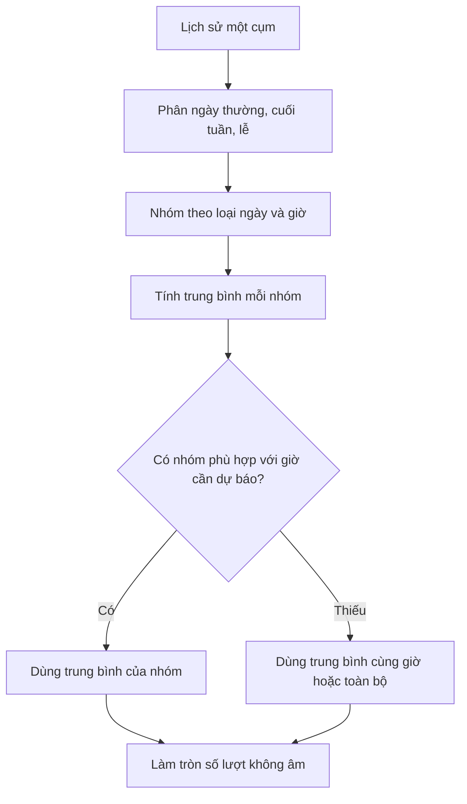

**Minh họa:** ba ngày thường có 3, 6 và 12 lượt lúc 17:00 thì dự báo 7 lượt cho 17:00 một ngày thường tiếp theo. Công thức nhóm $G$ là $\hat y=\frac{1}{|G|}\sum_{t\in G}y_t$. Mô hình này làm đường cơ sở và phương án dự phòng. [Hourly Mean](../ai_engine/forecast.py)

### 7.2. Random Forest · Nhiều cây hồi quy lấy trung bình

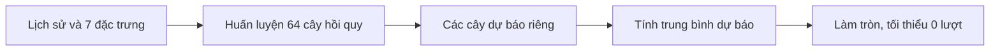

Mỗi cây chia dữ liệu bằng các câu hỏi về đặc trưng, chẳng hạn có phải cuối tuần hoặc lượt đến đúng 24 giờ trước ở mức nào. Mỗi lá trả một giá trị hồi quy. Random Forest của scikit-learn xây nhiều cây trên các mẫu huấn luyện và trung bình hóa chúng. Repo cấu hình **64 cây**, **tối thiểu 4 mẫu trong một lá**, một luồng chạy và seed. Công thức $\hat y=\frac1B\sum_{b=1}^B f_b(x)$. **Minh họa:** ba cây dự báo 6, 6, 12 thì trung bình là 8. [Cấu hình repo](../ai_engine/forecast.py) · [RandomForestRegressor](https://scikit-learn.org/stable/modules/generated/sklearn.ensemble.RandomForestRegressor.html)

### 7.3. XGBoost · Cây tăng cường theo gradient


Các cây được thêm tuần tự để giảm hàm mất mát. Có thể viết dạng cộng dồn $F_b(x)=F_{b-1}(x)+\eta f_b(x)$, trong đó $\eta$ là tốc độ học. Repo dùng **120 cây**, **độ sâu tối đa 4**, **tốc độ học 0,08**, hàm mất mát sai số bình phương `reg:squarederror`. Các cây sau điều chỉnh dự báo hiện tại. **Minh họa:** dự báo 9, cây mới đóng góp −2 sau khi tính tốc độ học, dự báo thành 7. [Cấu hình repo](../ai_engine/forecast.py) · [Mô hình cây tăng cường](https://xgboost.readthedocs.io/en/stable/tutorials/model.html)

### 7.4. Đặc trưng, cách đánh giá và chọn mô hình

Random Forest và XGBoost dùng bảy đặc trưng: **giờ, thứ, cờ cuối tuần, cờ ngày lễ, lượt đúng 24 giờ trước, lượt đúng 168 giờ trước và trung bình 24 giờ trước**. Khi thiếu dữ liệu lag, code dùng giá trị thay thế −1. Một giờ chưa có quan sát khác với một giờ đã ghi nhận 0 lượt.

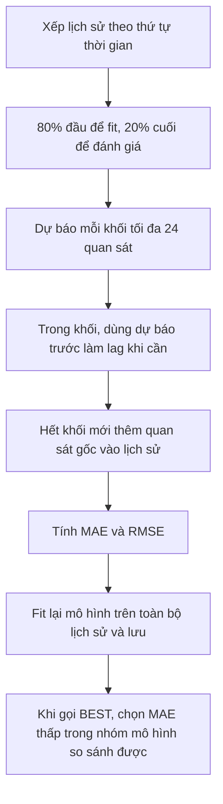

Bộ giải đánh giá không huấn luyện lại giữa các khối. Sau mỗi khối, nó cập nhật lịch sử đã quan sát cho bước dự báo kế tiếp. `BEST` chỉ so các model được huấn luyện trên cùng lịch sử đánh giá tương thích. Dưới 336 giờ quan sát hoặc thiếu bản mô hình phù hợp thì dùng Hourly Mean, với sai số holdout `null` nếu chưa có đánh giá. [Huấn luyện và chọn mô hình](../ai_engine/forecast.py)

Với $e_k=\hat y_k-y_k$ là sai số ở giờ thứ $k$:

$$
\mathrm{MAE}=\frac{1}{n}\sum_{k=1}^{n}|e_k|,\qquad
\mathrm{RMSE}=\sqrt{\frac{1}{n}\sum_{k=1}^{n}e_k^2}.
$$

Ví dụ lỗi 2 và 2 lượt cho MAE 2, RMSE 2. Lỗi 0 và 4 lượt cũng cho MAE 2 nhưng RMSE khoảng 2,83. Vì vậy có thể có hai mô hình đứng đầu theo hai chỉ số khác nhau.

Về độ phức tạp, với $H$ giờ lịch sử, sắp thứ tự tốn $O(H\log H)$, dựng đặc trưng theo độ dài lag cố định tốn $O(H)$. Dự báo $h$ giờ bằng Hourly Mean là $O(h)$ sau khi dựng bảng. Mô hình cây cần duyệt tối đa $O(hBd)$ với $B$ cây và độ sâu tối đa $d$. Chi phí fit phụ thuộc cấu hình và cách thư viện tìm điểm chia. Trong vòng đánh giá hiện tại, sao chép lịch sử ở đầu mỗi khối thêm cận $O(qH)$ cho $q$ khối. [Mã đánh giá và dự báo](../ai_engine/forecast.py)

## 8. Kết quả dự báo đo lại trên cùng dữ liệu

### 8.1. Nguồn và thiết kế lần đo

| Thuộc tính | Giá trị |
|---|---|
| Ngày đo | 20/11/2026 |
| Nguồn | **Mô phỏng.** `make_history(months=3, seed=42)` trong repo. |
| Hạt giống | Seed 42 cho bộ sinh và mô hình. `holidays=[]` cho thí nghiệm. |
| Dữ liệu tổng | 2.160 giờ, 90 ngày, từ 01/01 đến hết 31/03/2025, giờ Việt Nam. |
| Train | 1.728 giờ từ 01/01 00:00 đến 13/03 23:00. |
| Holdout | 432 giờ từ 14/03 00:00 đến 31/03 23:00, gồm 18 khối 24 giờ. |
| Nguồn số liệu | Hàm `train` trong repo. Sai số chi tiết theo giờ và nhóm được đối chiếu với MAE/RMSE tổng của `train`. |
| Môi trường | Windows, Python 3.12.10, scikit-learn 1.9.1, XGBoost 3.4.1, NumPy 2.5.2, pandas 2.3.3, joblib 1.6.0. |
| Vân tay dữ liệu | SHA-256 của JSON chuẩn hóa: `f084d1d03e5aaf8b2c9f10ed52372ac992356d631bbade57be4626a94b371d23`. |

Bộ sinh đặt sẵn chu kỳ ngày/tuần, cao điểm chiều và nhiễu ngẫu nhiên. Kết luận độ chính xác dưới đây áp dụng cho **lịch sử mô phỏng này**, làm cơ sở tái lập và kiểm tra quy trình. Đánh giá trên trạm thật cần chuỗi lượt đến ghi nhận thực tế. [Bộ sinh lịch sử](../ai_engine/scripts/make_fake_history.py) · [Hàm train](../ai_engine/forecast.py)

### 8.2. MAE và RMSE trên toàn bộ 432 giờ holdout

| Mô hình | MAE (lượt/giờ) ↓ | RMSE (lượt/giờ) ↓ |
|---|---:|---:|
| Hourly Mean | 2,7477 | 3,3799 |
| Random Forest | 1,9190 | 2,5581 |
| XGBoost | 1,8611 | 2,5847 |

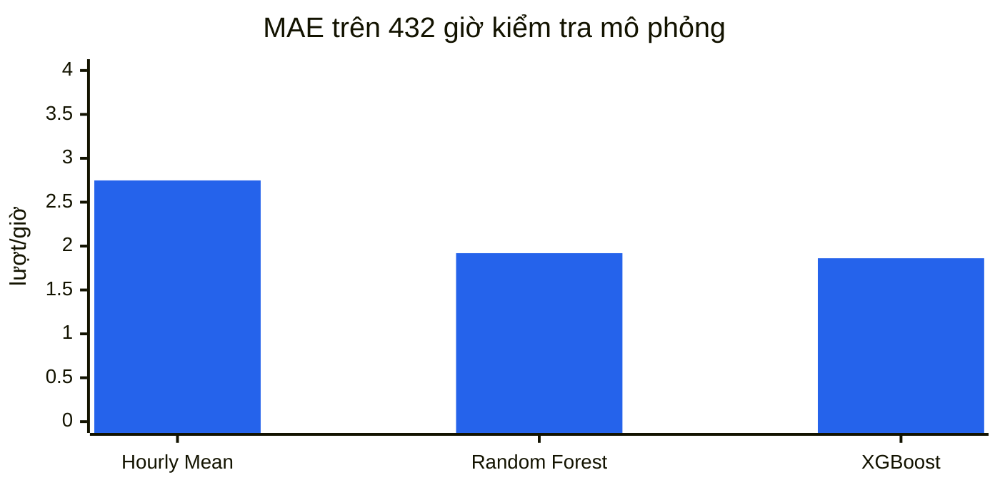

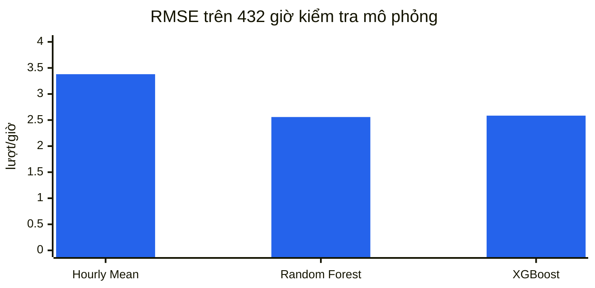

- **Theo MAE**, XGBoost thấp nhất ở **1,8611 lượt/giờ**, giảm **32,27%** so với Hourly Mean. Chế độ `BEST` chọn XGBoost trong lần đo.
- **Theo RMSE**, Random Forest thấp nhất ở **2,5581 lượt/giờ**. XGBoost có MAE thấp hơn và RMSE cao hơn một chút. Khi RMSE tăng trong một nhóm giờ, một số lệch lớn có thể kéo chỉ số lên dù sai số trung bình tuyệt đối vẫn thấp.
- Nếu cần phát biểu “độ chính xác” trong báo cáo, ghi **MAE và RMSE với đơn vị lượt/giờ**. Ví dụ, “XGBoost lệch tuyệt đối trung bình khoảng 1,86 lượt mỗi giờ trên tập mô phỏng”.

### 8.3. RMSE theo khoảng dự báo

H1 là giờ đầu tiên của mỗi lần dự báo 24 giờ, H24 là giờ cuối cùng. Mỗi nhóm 6 bước dưới đây có **108 quan sát**, vì có 18 khối.

| Bước trong khối dự báo | Số điểm | Hourly Mean | Random Forest | XGBoost |
|---|---:|---:|---:|---:|
| H1–H6 | 108 | 3,2404 | 2,1773 | 2,0184 |
| H7–H12 | 108 | 3,5316 | 2,3785 | 2,3432 |
| H13–H18 | 108 | 3,3638 | 3,0123 | 3,4601 |
| H19–H24 | 108 | 3,3775 | 2,5892 | 2,2771 |

Các giá trị là RMSE, đơn vị lượt/giờ, cùng lần đo mô phỏng. Chẳng hạn ở H13–H18, XGBoost có RMSE 3,4601 và Random Forest có 3,0123. Có thể dùng bảng này khi được hỏi mô hình sai ở phần nào của cửa sổ dự báo.

### 8.4. Dự báo theo từng giờ và số mô phỏng dùng làm đáp án

**Mô phỏng, ngày holdout đầu tiên 14/03/2025.** Đường xanh là **quan sát mô phỏng** do bộ sinh tạo. Đường cam là **dự báo XGBoost**. Bảng trích giờ giúp đối chiếu cả ba mô hình.

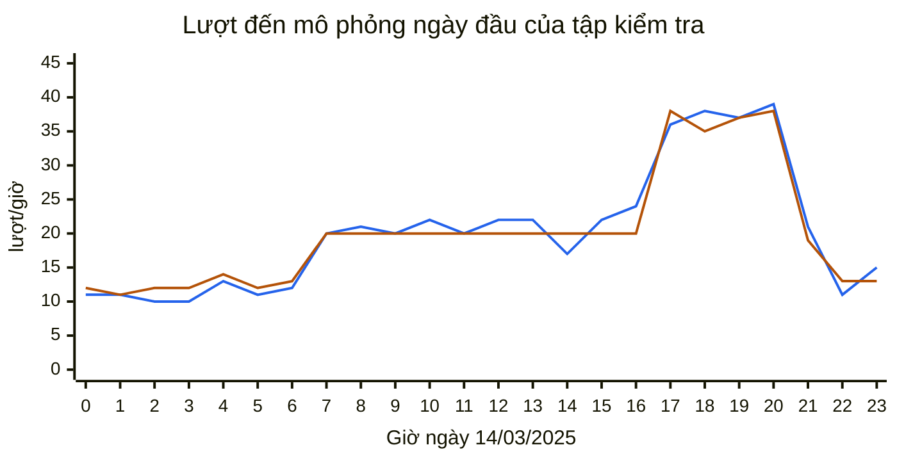

| Giờ | Quan sát mô phỏng | Hourly Mean | Random Forest | XGBoost |
|---|---:|---:|---:|---:|
| 00:00 | 11 | 8 | 11 | 12 |
| 07:00 | 20 | 16 | 19 | 20 |
| 12:00 | 22 | 16 | 20 | 20 |
| 16:00 | 24 | 16 | 20 | 20 |
| 17:00 | 36 | 34 | 38 | 38 |
| 18:00 | 38 | 34 | 35 | 35 |
| 19:00 | 37 | 34 | 37 | 37 |
| 20:00 | 39 | 34 | 38 | 38 |
| 21:00 | 21 | 16 | 19 | 19 |
| 23:00 | 15 | 8 | 13 | 13 |

Ví dụ lúc 18:00, quan sát mô phỏng 38 lượt và XGBoost dự báo 35 lượt, sai số tuyệt đối 3 lượt. MAE toàn phép đo tính trên **432 giờ**, bảng trên chỉ minh họa ngày đầu. Sau khi fit lại trên cả 2.160 giờ, `BEST` còn trả dự báo mới cho 01/04/2025. Lượt đo trả 5 lượt lúc 00:00 và 31 lượt lúc 17:00. Hai giá trị này là **đầu ra tương lai**, tách khỏi các điểm đã chấm trong holdout.

## 9. Kiểm thử và benchmark lập lịch

### 9.1. Kết quả test chạy lại ngày 20/11/2026

```text
python -m pytest ai_engine/tests -q
190 passed, 4 warnings in 43.87s
```

Môi trường Windows, Python 3.12.10, pytest 9.2.0 và OR-Tools 9.15.6755. Bốn cảnh báo là cảnh báo tương thích thư viện TestClient và SWIG. Thời gian tổng thay đổi theo máy và tải.

| Điều cần chứng minh | Ca kiểm tra trong repo | Kết quả |
|---|---|---|
| Cổng, kW và cân bằng năng lượng | Trùng cổng, vượt trần trạm/cụm, sai công suất bật/tắt, sai cân bằng kWh | Đạt trong lượt 190 test. [Validator](../ai_engine/tests/test_validator.py) |
| Thời gian và đầu vào | Qua nửa đêm, làm tròn slot, sai đầu nối, biểu giá hở/chồng | Đạt. [Normalizer](../ai_engine/tests/test_normalizer.py) · [Schema](../ai_engine/tests/test_schemas.py) |
| Các thuật toán đối chứng | Trần công suất, chia điện, cửa sổ và hành vi hết thời gian | Đạt. [Baselines](../ai_engine/tests/test_baselines.py) |
| Nghiệm nhiều mục tiêu và thời gian giải | Giữ nghiệm đã có khi hết ngân sách, giữ mục tiêu điện thiếu khi đi tiếp | Đạt. [MILP stages](../ai_engine/tests/test_milp_stages.py) |
| Tái lập lịch | Xe cũ và mới cùng pool, giữ phần điện đã nạp, cổng sự cố, trước/sau đổi lịch | Đạt. [Acceptance](../ai_engine/tests/test_acceptance.py) |
| API | Kết quả optimize, schema lỗi, timeout, benchmark và forecast | Đạt. [Test API AI](../ai_engine/tests/test_main.py) |
| Forecast | Đủ 24 giờ, số nguyên không âm, fallback, chọn BEST, MAE từng model không vượt 1,2 lần baseline trong fixture | Đạt. [Test Forecast](../ai_engine/tests/test_forecast.py) |

Ca concurrent trong suite này kiểm tra các lần giải đồng thời ở cấp engine. Chỉ số tải 10.000 phiên người dùng có phạm vi đo khác. [Ma trận nghiệm thu và phạm vi](../ai_engine/tests/test_acceptance.py)

### 9.2. Ca MILP bốn xe · Minh họa đã chạy lại

Cụm giới hạn 3 kW. Trạm S1 tối đa 4 kW, có cổng liên tục 2 kW. Trạm S2 tối đa 2 kW, có cổng bật/tắt 1 kW. Giá 17:00 là 4.000 đ/kWh, ba slot sau là 2.000 đ/kWh.

| Xe | kWh cần | Giờ rời | kWh được cấp trong lượt đo |
|---|---:|---:|---:|
| A | 1,00 | 18:00 | 1,00 |
| B | 0,50 | 17:45 | 0,50 |
| C | 0,50 | 17:30 | 0,50 |
| D | 0,50 | 18:00 | 0,50 |

| Slot bắt đầu | Phân bổ thực chạy trong test | Tổng cụm | Tiền điện |
|---|---|---:|---:|
| 17:00 | C ở cổng 201, 1 kW | 1 kW | 1.000 đ |
| 17:15 | B ở cổng 102, 2 kW. C ở cổng 201, 1 kW. | 3 kW | 1.500 đ |
| 17:30 | A ở cổng 102, 2 kW. D ở cổng 201, 1 kW. | 3 kW | 1.500 đ |
| 17:45 | A ở cổng 102, 2 kW. D ở cổng 201, 1 kW. | 3 kW | 1.500 đ |

**Kết quả chạy lại:** `MILP_MPC / OPTIMAL`, **2,50 kWh**, **0 kWh thiếu**, **4/4 đúng hạn**, **3 kW đỉnh**, **5.500 đ**, **0 vượt trần**. Xe C bắt buộc dùng hai slot trước 17:30, nên ít nhất 0,25 kWh phải mua ở giá cao. Tất cả 2,25 kWh còn lại mua ở giá thấp thì tổng là 5.500 đ. Đây là cách tự kiểm tra chi phí bằng tay. Các lịch khác vẫn có thể đạt cùng KPI. [Input đầy đủ](../ai_engine/samples/page20_input.json) · [Test và các phép đối chiếu](../ai_engine/tests/test_acceptance.py)

### 9.3. Ca LP thuần · Minh họa đã chạy riêng

Giữ **xe A, trạm 10 và cổng 101** từ input trên. Cổng duy nhất điều chỉnh liên tục 0–2 kW. Dùng cùng giá, horizon và trần cụm. Engine thực chạy `LP_MPC / OPTIMAL`. Ba slot giá thấp từ 17:15 nhận **1,333333 kW mỗi slot**. Tổng cấp **0,99999975 kWh**, chi phí **1.999,9995 đ**, thiếu **0 kWh** theo dung sai và **0** lần vượt trần. Con số hiển thị là **1,00 kWh và 2.000 đ**. Ca này xác nhận đường GLOP bằng cấu trúc input đủ điều kiện. [Snapshot gốc](../ai_engine/samples/page20_input.json) · [Bộ chọn solver](../ai_engine/optimizer_milp.py)

### 9.4. Benchmark đã lưu · Mô phỏng

Benchmark nhận danh sách thuật toán và số lần lặp, chạy từng thuật toán trên cùng snapshot/seed rồi tổng hợp KPI. Lưu cả tên được **yêu cầu** và tên **thực chạy** để đọc đúng khi chuyển solver.


**100 yêu cầu, TOU giả định, seed 42, báo cáo 19/11/2026.** Hai cụm có 59 và 41 yêu cầu, horizon 136 slot. Tất cả các dòng dưới đây có **94% đúng hạn**, thiếu **17,5719 kWh** và **0** lần vượt trần.

| Yêu cầu thuật toán | Thực chạy | Chi phí (đ) | Đỉnh (kW) | solve_ms |
|---|---|---:|---:|---:|
| MILP_MPC | MILP_MPC | 7.172.282,48 | 681,0700 | 15.708,39 |
| LP_MPC | MILP_MPC | 7.172.282,48 | 681,0700 | 15.926,78 |
| LLF | LLF | 7.190.587,84 | 684,0876 | 10,14 |
| EDF | EDF | 7.190.587,84 | 684,0876 | 11,34 |
| FCFS | FCFS | 7.207.205,28 | 773,6312 | 8,60 |
| EQUAL_SHARE | EQUAL_SHARE | 7.207.205,28 | 773,6312 | 9,94 |
| ASAP | ASAP | 7.207.205,28 | 773,6312 | 8,53 |

**Mốc lớn hơn, dữ liệu mô phỏng.** `solve_ms` là tổng thời gian hai cụm trong lần đo. Đây là số đo của engine trong benchmark, khác độ trễ mạng hoặc thời gian phản hồi booking.

| Mốc và giá | Thuật toán thực chạy | Đúng hạn | Thiếu (kWh) | Đỉnh (kW) | Vượt trần | solve_ms |
|---|---|---:|---:|---:|---:|---:|
| 500, TOU | LLF cụm 1 + MILP cụm 2 | 68,4% | 2.613,4802 | 850 | 0 | 11.331,22 |
| 500, TOU | LLF | 68,0% | 2.614,1306 | 850 | 0 | 59,23 |
| 500, TOU | ASAP | 67,0% | 4.777,7031 | 2.220 | 53 | 52,77 |
| 1.000, TOU | LLF | 52,2% | 5.184,4282 | 850 | 0 | 91,86 |
| 10.000, giá cố định | LLF | 1,74% | 224.282,5779 | 850 | 0 | 707,04 |
| 10.000, TOU | LLF | 1,74% | 224.282,5779 | 850 | 0 | 939,15 |

- **100 yêu cầu:** MILP giảm **0,2546%** chi phí và **0,4411%** đỉnh so với LLF, cùng mức phục vụ ở độ chính xác hiển thị. Dòng yêu cầu LP thực chạy MILP và vì vậy dùng ca ở mục 9.3 để minh chứng GLOP.
- **500 yêu cầu:** cụm 1 có 294 request nên vượt ngưỡng, cụm 2 có 206 request chạy MILP. So riêng cụm 2 với LLF ở giá TOU, MILP giảm **0,3952%** tiền điện và tăng **0,9709 điểm phần trăm** đúng hạn. ASAP ở mốc này tốn tiền ít hơn, nhưng cấp thiếu nhiều hơn và vượt trần **53** lần.
- **10.000 yêu cầu:** bộ dữ liệu có 5.882 và 4.118 yêu cầu mỗi cụm, nhu cầu khoảng **245.364 kWh**. Horizon chạy là **138 slot, 34,5 giờ**. Năng lực **20.400 kWh** là mốc tham chiếu bằng tổng trần kW nhân 24 giờ. Tỷ lệ 1,74% đi cùng kịch bản quá tải. Lượt đo dùng để đọc thông lượng LLF. Cần bài đo riêng để chứng minh tải người dùng đồng thời.

[Nguồn số liệu đầy đủ, cả hai biểu giá](../ai_engine/benchmark_real.json) · [Script gộp và tái đo](../ai_engine/scripts/benchmark_real.py) · [Cách đọc benchmark](../ai_engine/README.md#số-đo-trên-dữ-liệu-scenario-đã-commit)

## 10. Chạy lại các kết quả

Chạy từ thư mục gốc của repo, với môi trường đã cài [phụ thuộc chạy](../ai_engine/requirements.txt) và [phụ thuộc kiểm thử](../ai_engine/requirements-dev.txt).

### 10.1. Test và hai ca solver

```powershell
python -m pytest ai_engine/tests -q
python -m pytest ai_engine/tests/test_acceptance.py::test_page20 -q -s
```

Để tái lập ca LP, chạy đoạn Python sau từ thư mục gốc. Các trường giữ lại đều lấy trực tiếp từ mẫu đã bàn giao.

```python
import json
from pathlib import Path

from ai_engine.schemas import OptimizeRequest
from ai_engine.service import evaluate

raw = json.loads(Path("ai_engine/samples/page20_input.json").read_bytes())
raw["stations"] = raw["stations"][:1]
raw["stations"][0]["ports"] = raw["stations"][0]["ports"][:1]
raw["requests"] = raw["requests"][:1]

result = evaluate(OptimizeRequest.model_validate(raw))
print(result.status.value, result.algorithm.value, result.kpi.model_dump())
assert result.algorithm.value == "LP_MPC"
assert abs(result.kpi.total_cost_vnd - 2000) < 0.001
assert result.kpi.cap_violations == 0
```

### 10.2. MAE/RMSE, nhóm bước và dự báo chi tiết

Đoạn dưới dùng bộ sinh cố định và lưu mô hình trong thư mục tạm. `train` chạy sản phẩm thực tế. Phần tính chi tiết lặp lại đúng cách chia khối của `train` rồi đối chiếu với sai số hàm đó trả về.

```python
import hashlib
import json
import math
from pathlib import Path
from tempfile import TemporaryDirectory

from ai_engine.forecast import NAMES, _fit, _one, _series, forecast, train
from ai_engine.scripts.make_fake_history import make_history

def metrics(errors):
    return {
        "mae": sum(abs(e) for e in errors) / len(errors),
        "rmse": math.sqrt(sum(e * e for e in errors) / len(errors)),
    }

rows = make_history(months=3, seed=42)
encoded = json.dumps(rows, sort_keys=True, separators=(",", ":")).encode("utf-8")
print("data_sha256", hashlib.sha256(encoded).hexdigest())

cluster = "synthetic-docs"
ordered = list(_series(rows, cluster).items())
cut = int(0.8 * len(ordered))
print("train", cut, "test", len(ordered) - cut)
print("actual first block", [y for _, y in ordered[cut:cut + 24]])

with TemporaryDirectory() as folder:
    root = Path(folder)
    for name in NAMES:
        trained = train(rows, name, cluster, holidays=[], models_dir=root, seed=42)
        past = dict(ordered[:cut])
        model = _fit(name, past, set(), 42)
        errors, by_lead, first = [], [[] for _ in range(4)], []
        for start in range(cut, len(ordered), 24):
            block = ordered[start:start + 24]
            scratch = past.copy()
            for lead, (t, y) in enumerate(block):
                guess = _one(name, model, t, scratch, set())
                errors.append(guess - y)
                by_lead[lead // 6].append(guess - y)
                if start == cut:
                    first.append(guess)
                scratch[t] = guess
            past.update(block)
        measured = metrics(errors)
        assert all(math.isclose(measured[k], trained["metrics"][k],
                                abs_tol=1e-10) for k in measured)
        print(name, measured)
        print("RMSE by lead group", [metrics(group)["rmse"] for group in by_lead])
        print("predictions first block", first)
    best = forecast(cluster, rows, horizon_hours=24, model="BEST",
                    models_dir=root, holidays=[])
    print("BEST", best["model"], best["metrics"], best["predictions"])
```

### 10.3. Tái lập benchmark lập lịch

Báo cáo lưu seed 42 và SHA-256 của các CSV nguồn ở Git ref `b0fc3f7`. Lệnh sau chạy lại benchmark và **ghi đè** kết quả tại `ai_engine/benchmark_real.json`.

```powershell
python -m ai_engine.scripts.benchmark_real --dataset-ref b0fc3f7
```

Độ trễ và nghiệm `FEASIBLE` có thể thay đổi theo máy và ngân sách thời gian. Các mức TOU 1.600/2.400/4.000 đ/kWh trong kịch bản là **giả định**. [Tham số và đầu ra script](../ai_engine/scripts/benchmark_real.py) · [Báo cáo số đo lưu trong repo](../ai_engine/benchmark_real.json)

## 11. Phạm vi khi bảo vệ kết quả

| Câu hỏi | Cách trả lời có cơ sở |
|---|---|
| Nhóm đã build phần gì? | Mô hình ràng buộc và mục tiêu, chọn GLOP/SCIP, 5 chính sách đối chứng, LLF khởi tạo/dự phòng, tái lập lịch từ snapshot, Validator, Explainer, API và benchmark. Khối dự báo có 3 mô hình và đánh giá theo thời gian. |
| Mô hình nào dự báo tốt nhất? | Trên 432 giờ mô phỏng trong tài liệu này, XGBoost tốt nhất theo MAE và Random Forest tốt nhất theo RMSE. Nêu rõ chỉ số và nguồn dữ liệu. |
| MILP có luôn cho mọi xe đủ điện? | Nghiệm tối ưu tuân thủ trần và có thể còn `shortfall_kwh`. Tài nguyên khả dụng và deadline giới hạn lượng điện có thể cấp. |
| Số 10.000 chứng minh điều gì? | LLF đã xử lý kịch bản 10.000 yêu cầu sạc mô phỏng ở hai cụm. Độ trễ booking đồng thời và quy mô giải MILP là những phép đo khác. |
| NSGA-II, CP-SAT và Master LP nằm ở đâu? | NSGA-II là phương án phân tích đánh đổi Pareto và API báo `NOT_IMPLEMENTED`. CP-SAT và phân rã Master LP–Station Worker là phương án thiết kế. Bản hiện tại có SCIP, GLOP và LLF toàn cụm. |
| AI có tính chai pin? | Bộ lập lịch có giới hạn kW của xe và mục tiêu ổn định bật/tắt ở tầng cuối. Độ hao mòn pin theo thời gian nằm ngoài hàm mục tiêu hiện có. |

[Thiết kế và phạm vi dự án](../CLAUDE.md) · [AI Engine README](../ai_engine/README.md) · [Hướng dẫn thiết kế chi tiết](huong_dan.md)

## 12. Thay đổi chưa merge · Sạc liền mạch

Phạm vi đối chiếu là **`feat/non-preemptive-charging` ở `23c40e7`** so với **`origin/develop` ở `ad6c54f`**. Bảy commit thêm logic giữ khối sạc liên tiếp, kiểm thử và benchmark. Mã `forecast.py` và bộ sinh lịch sử giữ cùng nội dung với bản dùng để đo ở mục 8. Các chỉ số forecast ở đó vẫn là kết quả phép đo mô phỏng trước.

### 12.1. Yêu cầu mới thay đổi mô hình ra sao?

Ở bản nền, xe có thể được cấp điện ở các slot rời nhau nếu đúng cổng và các ràng buộc khác. Bản đề xuất yêu cầu **một khối slot cấp điện liên tiếp trên tối đa một cổng** trong phạm vi lịch được kiểm tra. Một xe vẫn có thể bắt đầu muộn để đợi khung giá rẻ. Trong khối sạc, cổng liên tục có thể đổi mức kW; cổng đóng/ngắt dùng công suất định mức khi bật.

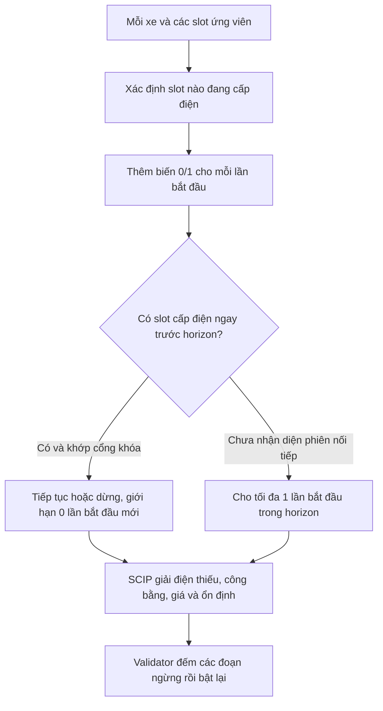

Trong MILP, đặt:

- $u_{it}=\sum_j x_{ijt}$, bằng 1 nếu xe $i$ sạc ở slot $t$.
- $b_{it}\in\{0,1\}$ là biến **bắt đầu sạc ở slot $t$**.

Với $u_{i,t-1}$ lấy từ slot ngay trước, code dùng ba điều kiện:

$$
b_{it}\ge u_{it}-u_{i,t-1},\qquad
b_{it}\le u_{it},\qquad
b_{it}\le 1-u_{i,t-1}.
$$

Điều này chỉ cho $b_{it}=1$ khi trạng thái chuyển **0 → 1**. Dãy **0–1–1–0** có một lần bắt đầu và hợp lệ. Dãy **1–0–1** có hai lần bắt đầu nếu chưa sạc từ trước, nên bị chặn. Xe mới có $\sum_t b_{it}\le1$. Nếu Normalizer đã nhận diện khối sạc từ trước, giới hạn số lần bắt đầu mới là 0. [Mã MILP](#128-nguồn-mã-theo-commit)

**Mức sàn khi bật.** Cổng có sàn khai báo dương dùng mức sàn đó. Cổng khai báo sàn 0 dùng giá trị số **0,001 kW**, giới hạn bởi công suất khả dụng, ở MILP và các baseline có biến trạng thái cấp điện. Nhờ đó slot bật có công suất lớn hơn dung sai Validator $10^{-6}$ kW. GLOP còn được dùng khi cửa sổ có tối đa hai slot, cổng liên tục từ 0 kW, tối đa một cổng ứng viên, không tranh cổng và không có bằng chứng nối từ trước. Hai slot kề nhau không tạo được dãy bật–tắt–bật. [Mã nguồn và số liệu theo commit](#128-nguồn-mã-theo-commit)

### 12.2. LLF, MPC và Validator thay đổi ở đâu?

```mermaid
flowchart TD
    A["Đầu slot LLF"] --> B["Xác định xe vừa sạc và còn nhu cầu"]
    B --> C["Giữ công suất sàn khả dụng cho các xe đang sạc"]
    C --> D["Dùng phần ngân sách còn lại theo slack"]
    D --> E["Ghi lịch và cập nhật slot cấp điện cuối"]
    E --> F["Sang slot kế tiếp"]
```

| Mã nguồn trên nhánh | Hành vi đã triển khai |
|---|---|
| `normalizer.py` | Nhận diện dòng công suất dương ở slot liền trước horizon nếu yêu cầu là `CHARGING` và cổng khớp cổng khóa. Lưu dấu qua `prior_on_slot`. Nếu snapshot giữa slot và thiếu dòng slot đang chạy, việc lập lịch bắt đầu từ slot sửa được kế tiếp. |
| `baselines.py` | Các chính sách giữ một khối cấp điện trong lượt lập lịch. LLF xếp xe vừa sạc lên trước xe mới. Trước khi chia thêm công suất, nó chừa mức sàn cho các xe đang sạc trong giới hạn trạm/cụm. |
| `optimizer_milp.py` | Thêm biến bắt đầu và ràng buộc một khối. Xe đang `CHARGING` giữ cổng khóa. Nếu cổng đó hỏng, lịch có thể trả thiếu điện. Xe chưa ở trạng thái `CHARGING` có thể đổi sang cổng tương thích trong các trường hợp code cho phép. |
| `validator.py` | Sắp các slot công suất dương theo xe. Nếu một slot mới cách slot có điện trước đó hơn 15 phút, ghi `CHARGING_INTERRUPTED` và tăng bộ đếm. |
| `service.py`, `schemas.py`, `main.py` | Đưa `interruptions` vào KPI. Benchmark lấy số gián đoạn lớn nhất qua các lần lặp hợp lệ và script gộp cộng theo cụm. Dữ liệu cũ thiếu phép đo có thể hiển thị `null`. |

Sau thay đổi, đặt $U$ là số cặp xe–slot có ít nhất một biến bật. MILP thêm tối đa $O(U)$ biến nhị phân và ràng buộc, với $U\le C$ nếu $C$ là số bộ ba xe–cổng–slot ứng viên. Cỡ mô hình thưa vẫn tăng theo $O(N+K+C)$, nhưng số biến nhị phân lớn hơn và đường LP chọn lọc hơn. LLF thêm một lượt giữ sàn $O(a_t)$ ở mỗi slot với $a_t$ xe đang xét. Validator thêm sắp các tập slot của từng request trong $O(\sum_i R_i\log(R_i+1))$, với $R_i$ là số slot cấp điện cho xe $i$.

Nhánh kế thừa đường xử lý timeout từ bản nền `ad6c54f`. Khi worker optimize hết hạn, API thử LLF và kiểm tra lịch trước khi trả `FALLBACK`; `ERROR` dùng khi không có kết quả hợp lệ. Đó là thay đổi đã có trong bản nền mới, còn ràng buộc liền mạch là phần đang chờ merge. [Mã nguồn và số liệu theo commit](#128-nguồn-mã-theo-commit)

### 12.3. Kết quả kiểm thử chạy lại

| Kiểm tra trên `23c40e7` | Kết quả ngày 20/11/2026 |
|---|---|
| `python -m pytest ai_engine/tests -q` | **208 đạt**, 4 cảnh báo thư viện, 45,95 giây. Bao gồm bài bốn xe, các ca liền mạch, MPC, Validator và forecast. |
| `python -m pytest ai_engine/tests/test_nonpreemptive.py -q` | **15 đạt** chạy riêng, 1,70 giây. Đây là một phần của 208 ca ở trên. |
| `python -m pytest backend/tests -q` | **58 đạt**, 1 cảnh báo thư viện, 7,29 giây. Các phiên bản `psycopg2-binary==2.9.13` và `openpyxl==3.1.5` được nạp từ thư mục phụ thuộc tạm để chạy đủ suite. |
| Bài bốn xe **Minh họa** | `MILP_MPC / OPTIMAL`, 4/4 xe đủ điện, đỉnh 3 kW, giá 5.500 đ, 0 vượt trần. Xe A sạc liên tiếp lúc 17:30 và 17:45. |
| GLOP hai slot **Minh họa** | `LP_MPC / OPTIMAL`, hai slot 2 kW, đủ 1 kWh, 2.500 đ, 0 vượt trần và 0 gián đoạn. |

**Các ca đối chiếu mô phỏng chạy cùng input ở hai phiên bản.** Một cổng liên tục, tối đa 2 kW, sàn 1,4 kW, xe cần 1 kWh. Ba slot 17:00, 17:15, 17:30 có giá 1.000, 4.000 và 1.000 đ/kWh.

| Ca | Bản nền `ad6c54f` | Bản đề xuất `23c40e7` |
|---|---|---|
| Xe mới, chưa cấp điện | Hai slot **17:00 và 17:30** ở 2 kW, đủ 1 kWh, **1.000 đ**. | Hai slot **17:00 và 17:15** ở 2 kW, đủ 1 kWh, **2.500 đ**, `interruptions=0`. |
| `CHARGING`, cùng cổng, đã cấp 0,5 kWh ở 16:45, chốt 17:00 | Cấp 0,5 kWh còn lại lúc **17:30**. | Tiếp tục ngay lúc **17:00**, đủ 0,5 kWh còn lại, `interruptions=0`. |
| `CHARGING`, cùng cổng, đã cấp 0,5 kWh ở 16:30, thiếu dòng 16:45, chốt 17:00 | Cấp tiếp lúc **17:30**. | Vẫn có thể cấp tiếp lúc **17:30**. `prior_on_slot` rỗng, `interruptions=0`. |
| Xe mới, cùng bài ba slot nhưng cổng khai báo sàn 0 | Ca dùng để kiểm tra riêng bản đề xuất. | Cấp **1,9995 / 0,001 / 1,9995 kW** qua ba slot. Đủ 1 kWh, **1.000,75 đ**, 0 gián đoạn theo Validator. |

[Mã nguồn và số liệu theo commit](#128-nguồn-mã-theo-commit)

### 12.4. Benchmark trước và sau · Mô phỏng

Đối chiếu hai file `ai_engine/benchmark_real.json` tại `ad6c54f` và `23c40e7`. Hai báo cáo cùng dùng seed **42** và dữ liệu commit **`14cec6f18206987e9197b9f4bf391c3457001715`**. TOU ghi trong hai file gồm **1.620/2.700/4.212 đ/kWh**. Mốc 100 chạy 136 slot, các mốc dưới đây từ 500 trở lên chạy 138 slot. `solve_ms` cộng theo cụm.

| Kịch bản | Chỉ số | `ad6c54f` | `23c40e7` |
|---|---|---:|---:|
| 100, TOU, MILP | Chi phí (đ), đúng hạn | 8.276.432,26 · 94% | 8.276.432,26 · 94% |
| 500, TOU, LLF | Đúng hạn, điện thiếu (kWh) | 68% · 2.614,1306 | 73% · 2.549,4269 |
| 500, TOU, LLF cụm 1 + MILP cụm 2 | Đúng hạn, điện thiếu (kWh) | 68,4% · 2.613,4802 | 72% · 2.549,0329 |
| 500, TOU, LLF cụm 1 + MILP cụm 2 | Chi phí (đ), vượt trần | 42.054.657,06 · 0 | 42.256.368,57 · 0 |
| 10.000, giá cố định, LLF | solve_ms, đúng hạn | 1.052,56 · 1,74% | 1.844,59 · 1,59% |

**Phép đo kiểm tra độc lập:** chạy LLF ở từng phiên bản trên cùng hai snapshot của mốc 500, cấu hình TOU ở trên. Từ lịch trả về, lấy các slot có công suất trên $10^{-6}$ kW, sắp theo yêu cầu và đếm khoảng giữa hai slot có điện lớn hơn 15 phút. SHA-256 CSV của ca này là `d77edcd1999316a25ac5c9d41e83b4dc03d738e719c9aef081f3dcb6ac5d45d1`.

| Cụm | Số yêu cầu | Số lần bật lại bản nền | Bản đề xuất | Vượt trần trước/sau |
|---|---:|---:|---:|---:|
| 1 | 294 | 72 | 0 | 0 / 0 |
| 2 | 206 | 32 | 0 | 0 / 0 |
| **Tổng** | **500** | **104** | **0** | **0 / 0** |

```mermaid
xychart-beta
    title "LLF với 500 yêu cầu mô phỏng"
    x-axis ["Bản nền", "Bản sạc liền mạch"]
    y-axis "Lần bật lại" 0 --> 110
    bar [104, 0]
```

- **Tiền điện và mức phục vụ cần đọc cùng nhau.** Ở mốc 500 TOU, phương án yêu cầu MILP thực chạy LLF ở cụm 294 yêu cầu và MILP ở cụm 206 yêu cầu. Trên bản đề xuất, chỉ xét cụm 206, MILP giảm **0,3055%** tiền điện so với LLF và thiếu **1.482,4681 kWh** thay vì **1.482,8621 kWh**. Tỷ lệ đủ điện đúng hạn của MILP là **63,59%**, LLF là **66,02%**. Tổng kWh thiếu và số xe đủ 100% là hai thước đo khác nhau.
- **ASAP có thể liền mạch nhưng vẫn quá tải.** Ở mốc 500, ASAP trên bản đề xuất có 0 lần bật lại và **53 lần vượt trần**. Điều này cho thấy KPI gián đoạn cần đi cùng KPI trần công suất.
- **10.000 là phép đo LLF trên hai cụm ở kịch bản quá tải.** Tỷ lệ đúng hạn thấp và thời gian tăng là các chi phí quan sát được ở lượt đo này. Những con số đó không đo độ trễ của 10.000 người dùng truy cập đồng thời.

[Mã nguồn và số liệu theo commit](#128-nguồn-mã-theo-commit)

Từ checkout có hai commit, đọc JSON gốc và chạy các test mới bằng:

```powershell
git show ad6c54f:ai_engine/benchmark_real.json
git show 23c40e7:ai_engine/benchmark_real.json
python -m pytest ai_engine/tests/test_nonpreemptive.py -q
```

Lệnh pytest chạy trong checkout của `23c40e7`. Để tái đo đủ bốn mốc, script benchmark dùng `--dataset-ref 14cec6f18206987e9197b9f4bf391c3457001715` và ghi đè `ai_engine/benchmark_real.json` của checkout đang chạy. [Script benchmark](#128-nguồn-mã-theo-commit)

### 12.5. Phạm vi bảo đảm trước khi merge

1. **Tính liền mạch qua nhiều lần giải.** Với ca 16:30 → nghỉ → 17:30 ở bảng kiểm tra, lịch mới báo 0 gián đoạn vì chỉ lưu dấu nối tiếp từ slot liền trước horizon. Nếu yêu cầu là mỗi phiên chỉ có một khối dù MPC chạy lại nhiều lần, cần lưu trạng thái đã bắt đầu/đã dừng dựa trên lịch sử cấp điện và kiểm thử chuỗi snapshot. Có thể dùng ca thiếu dòng ở 16:45 để tái hiện điểm này. [Điều kiện nhận diện slot liền trước](#128-nguồn-mã-theo-commit)
2. **Sàn số và sàn thiết bị.** Slot 0,001 kW tương đương **1 W**, hoặc **0,00025 kWh trong 15 phút**. Trong mô hình nó giúp biểu diễn biến bật, còn khả năng duy trì sạc với công suất đó phụ thuộc thiết bị. Khi yêu cầu vận hành là sạc thật liền mạch, cần sàn công suất phù hợp cho mỗi kiểu cổng. Kết quả hiện đo lịch mô phỏng, còn tuổi thọ pin và tác động lên contactor cần phép đo riêng. [Mức công suất số](#128-nguồn-mã-theo-commit)
3. **Quy ước PR.** Workflow yêu cầu tiền tố `feature/` cho nhánh tính năng. Tên local `feat/non-preemptive-charging` sẽ vướng kiểm tra tên nếu dùng trực tiếp để mở PR. [Workflow kiểm tra tên nhánh](#128-nguồn-mã-theo-commit)

### 12.6. Tái hiện hai trường hợp biên

Chạy đoạn Python sau trong checkout `23c40e7`. Đầu ra in công suất từng slot cùng `interruptions`.

```python
from ai_engine.schemas import OptimizeRequest
from ai_engine.service import evaluate
from ai_engine.tests.test_nonpreemptive import charging_case

def run(minimum, previous=None):
    raw = charging_case(minimum=minimum)
    raw["time_budget_ms"] = 5000
    raw["stations"][0]["ports"] = raw["stations"][0]["ports"][:1]
    if previous is not None:
        raw["requests"][0].update(
            status="CHARGING",
            locked_port_id=101,
            arrival_time="2026-11-18T16:30:00+07:00",
            energy_delivered_kwh=0.5,
        )
        raw["previous_schedule"] = [{
            "request_id": "A",
            "port_id": 101,
            "slot_start": f"2026-11-18T{previous}:00+07:00",
            "power_kw": 2,
        }]
    response = evaluate(OptimizeRequest.model_validate(raw))
    slots = [(s.slot_start.strftime("%H:%M"), s.power_kw) for s in response.schedules]
    print(previous, minimum, slots, response.kpi.interruptions)

run(1.4, "16:45")
run(1.4, "16:30")
run(0)
```

Hai lượt đầu khác nhau ở thời điểm của dòng cấp điện cũ. Dòng 16:45 cho phép nhận diện tiếp tục lúc 17:00. Dòng 16:30 đứng trước phạm vi đó, nên là ca kiểm tra bảo đảm xuyên qua nhiều snapshot. Lượt cuối thể hiện cách sàn số giữ biến bật qua slot giá cao.

### 12.7. Thí nghiệm MPC hai lần gọi API

**Mô phỏng chạy ngày 21/11/2026** trên mã `23c40e7`. Dùng một trạm với **hai cổng bật/tắt định mức 2 kW**, trần trạm và cụm đều **2 kW**. Giá trước 17:15 là **1.000 đ/kWh**, từ 17:15 là **3.000 đ/kWh**. Trong thí nghiệm, A có trọng số 2, B có trọng số 1. Đây là tham số snapshot để minh họa cách MILP chọn nghiệm.

```mermaid
sequenceDiagram
    participant BE as Bên gọi API
    participant AI as AI Engine
    BE->>AI: 16:45, snapshot mpc-1 chỉ có A cần 1 kWh
    AI-->>BE: A ở cổng 101 tại 16:45 và 17:00
    Note over BE: Giả lập A đã nhận 0,5 kWh trong slot đầu
    BE->>AI: 17:00, snapshot mpc-2 có A đang sạc và B mới
    Note over AI: Giữ cổng 101, nhận diện slot 16:45 và giải phần còn lại
    AI-->>BE: MILP xếp A lúc 17:00, B còn thiếu 0,5 kWh
```

**Lần 1, 16:45.** A đến 16:45, rời 18:00 và yêu cầu 1 kWh. `POST /ai/optimize` trả `MILP_MPC / OPTIMAL`. Xe A dùng **cổng 101**, 2 kW ở hai slot bắt đầu **16:45 và 17:00**, tổng 1 kWh và 1.000 đ theo lịch dự kiến.

**Lần 2, 17:00.** Giả lập slot đầu đã cấp **0,5 kWh**. Snapshot lập lịch mới có những thay đổi sau:

| Trường | Xe A | Xe B |
|---|---|---|
| `status` | `CHARGING` | `PENDING` |
| `arrival_time` / `departure_time` | 16:45 / 18:00 | 17:00 / 17:15 |
| `energy_needed_kwh` | 1,00 | 0,50 |
| `energy_delivered_kwh` | 0,50 | 0 |
| Điện còn cần | **0,50 kWh** | **0,50 kWh** |
| `locked_port_id` | 101 | Chưa khóa |
| `priority_weight` | 2 | 1 |

`previous_schedule[]` của snapshot thứ hai chứa dòng A ở cổng 101 lúc **16:45**. Normalizer của nhánh đề xuất ghi `prior_on_slot["A"] = -1` vì đó là slot liền trước horizon. `first_mutable_slot = 0` vì snapshot chốt đúng 17:00 và không có dòng khóa cho slot 17:00. Hai xe đều còn cần 0,5 kWh sau khi tách lượng điện đã giao ra khỏi phần phải xếp mới.

**Kết quả trên cùng snapshot thứ hai.** Dòng mặc định đến từ `POST /ai/optimize`. Các dòng đối chứng chạy qua `POST /ai/benchmark` với `seed=42` và `repeats=1`.

| Thuật toán gọi | Thực chạy | Phân bổ tại 17:00, tất cả ở 2 kW/cổng | A thiếu | B thiếu | Vượt trần |
|---|---|---|---:|---:|---:|
| Optimizer mặc định | MILP_MPC | A ở 101 | 0 | 0,50 kWh | 0 |
| MILP_MPC | MILP_MPC | A ở 101 | 0 | 0,50 kWh | 0 |
| LP_MPC | MILP_MPC | A ở 101 | 0 | 0,50 kWh | 0 |
| LLF | LLF | A ở 101 | 0 | 0,50 kWh | 0 |
| FCFS | FCFS | A ở 101 | 0 | 0,50 kWh | 0 |
| EDF | EDF | B ở 102 | 0,50 kWh | 0 | 0 |
| EQUAL_SHARE | EQUAL_SHARE | A ở 101 | 0 | 0,50 kWh | 0 |
| ASAP | ASAP | A ở 101 và B ở 102 | 0 | 0 | 2 |

- **MILP xét cả horizon.** Trong nhánh liền mạch, cho B sạc lúc 17:00 đồng nghĩa A dừng và không được bắt đầu lại trong horizon đó. Khi cho A tiếp tục, mục tiêu điện thiếu có trọng số là $2\times0+1\times0{,}5=0{,}5$. Khi cho B sạc, mục tiêu là $2\times0{,}5+1\times0=1$. MILP chọn A. Chi phí tối ưu trả cho phần điện **còn lại** của A là **500 đ**.
- **LLF giữ phiên đang sạc đã được nhận diện**, nên dành công suất sàn 2 kW cho A trước khi xét xe mới. **FCFS** cũng chọn A nhưng theo giờ đến. **EDF** chọn B vì B phải đi trước. **Equal Share** chỉ bật được một cổng trong ca này vì sàn mỗi cổng bằng 2 kW.
- **LP chỉ chạy GLOP khi cấu trúc thỏa điều kiện**. Ở đây cổng chỉ bật/tắt nên đường gọi `LP_MPC` đi qua SCIP. Ca GLOP hai slot ở mục 12.3 cho thấy trường hợp LP thuần chạy được.
- **ASAP** dùng đồng thời 4 kW và vượt cả trần trạm lẫn trần cụm trong cùng slot. Đây là ngoại lệ dành cho đối chứng benchmark. Bộ đếm gián đoạn của các dòng trên đều là 0 trong lần chạy cụ thể này. Với EDF, A dừng và không bật lại trong horizon.

**So với mã nền `8b247c1`.** Cùng input 17:00, bộ chuẩn hóa cũ cho `first_mutable_slot = 1` khi A đã ở trạng thái `CHARGING` dù payload chỉ mang dòng lịch đầu 16:45. Lượt `/ai/optimize` của bản cũ xếp 0,5 kWh còn lại cho A ở **17:45**, tốn **1.500 đ** cho phần còn lại. B cần xong lúc 17:15 nên thiếu 0,5 kWh. Bản đề xuất nhận diện dòng 16:45 và cấp phần còn lại lúc **17:00**. So sánh này bao gồm thay đổi cách chuẩn hóa slot đầu và điều kiện liền mạch.

#### Chạy lại thí nghiệm

Đoạn dưới dùng input mẫu của project, thay thông số ca mô phỏng rồi chạy hai lần `optimize` với một lượt `benchmark`. Chạy với mã AI Engine ở commit `23c40e7` để nhận kết quả trên.

```python
import json
from pathlib import Path

from fastapi.testclient import TestClient
from ai_engine.main import app

def stamp(clock):
    return f"2026-11-18T{clock}:00+07:00"

data = json.loads(Path("ai_engine/samples/page20_input.json").read_bytes())
data.update(input_version="mpc-1", snapshot_time=stamp("16:45"),
            horizon_slots=5, time_budget_ms=5000, grid_limit_kw=2)
data["stations"] = data["stations"][:1]
data["stations"][0]["station_power_kw"] = 2
for port in data["stations"][0]["ports"]:
    port.update(control_type="ON_OFF_SWITCH", min_power_kw=2, max_power_kw=2)
data["requests"] = data["requests"][:1]
a = data["requests"][0]
a.update(status="PENDING", arrival_time=stamp("16:45"),
         departure_time=stamp("18:00"), energy_needed_kwh=1,
         energy_delivered_kwh=0, priority_weight=2, locked_port_id=None)
data["tariffs"] = [
    dict(start_time="16:45", end_time="17:15", price_vnd_kwh=1000),
    dict(start_time="17:15", end_time="18:00", price_vnd_kwh=3000),
]

def show(label, result):
    print(label, result["algorithm"], result["status"],
          [(x["request_id"], x["port_id"], x["slot_start"][11:16], x["power_kw"])
           for x in result["schedules"]],
          [(x["request_id"], x["shortfall_kwh"]) for x in result["request_results"]],
          result["kpi"]["cap_violations"])

with TestClient(app) as client:
    first = client.post("/ai/optimize", json=data).json()
    show("mpc-1", first)
    executed = next(row for row in first["schedules"]
                    if row["slot_start"] == stamp("16:45"))
    data.update(input_version="mpc-2", snapshot_time=stamp("17:00"),
                horizon_slots=4, previous_schedule=[executed])
    a.update(status="CHARGING", locked_port_id=executed["port_id"],
             energy_delivered_kwh=executed["power_kw"] * 0.25)
    data["requests"].append(dict(a, request_id="B", status="PENDING",
        locked_port_id=None, arrival_time=stamp("17:00"), departure_time=stamp("17:15"),
        energy_needed_kwh=0.5, energy_delivered_kwh=0, priority_weight=1))
    show("mpc-2", client.post("/ai/optimize", json=data).json())
    run = client.post("/ai/benchmark", json=dict(
        scenario_id="mpc-2", snapshot=data, repeats=1, seed=42,
        algorithms=["MILP_MPC", "LP_MPC", "LLF", "FCFS", "EDF", "EQUAL_SHARE", "ASAP"],
    )).json()
    for row in run["results"]:
        show(row["algorithm"], row["result"])
```

### 12.8. Nguồn mã theo commit

Mã sạc liền mạch nằm tại **`23c40e7`**. Các lệnh sau đọc đúng phiên bản ngay trong repo, kể cả khi thư mục checkout riêng của nhánh đã được dọn. Các lệnh chỉ đọc nội dung.

| Nội dung | Lệnh đọc mã hoặc kết quả |
|---|---|
| Nhận diện slot trước horizon và slot sửa được | `git show 23c40e7:ai_engine/normalizer.py` |
| Chọn LP/MILP, khóa cổng và biến bắt đầu | `git show 23c40e7:ai_engine/optimizer_milp.py` |
| LLF và các chính sách đối chứng | `git show 23c40e7:ai_engine/baselines.py` |
| Validator và đếm gián đoạn | `git show 23c40e7:ai_engine/validator.py` |
| Sàn số và ngưỡng tải | `git show 23c40e7:ai_engine/settings.py` |
| API và hợp đồng KPI | `git show 23c40e7:ai_engine/main.py`, `git show 23c40e7:ai_engine/schemas.py` |
| Test liền mạch, MPC và ca bốn xe | `git show 23c40e7:ai_engine/tests/test_nonpreemptive.py`, `git show 23c40e7:ai_engine/tests/test_acceptance.py` |
| Benchmark thô và phần so sánh | `git show 23c40e7:ai_engine/benchmark_real.json`, `git show 23c40e7:ai_engine/README.md` |
| Script tạo benchmark | `git show 23c40e7:ai_engine/scripts/benchmark_real.py` |
| Quy ước tên nhánh tại commit | `git show 23c40e7:.github/workflows/pr-check.yml` |
